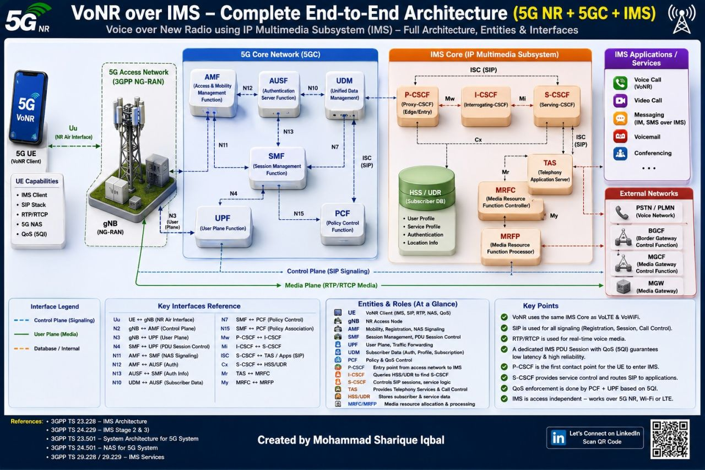
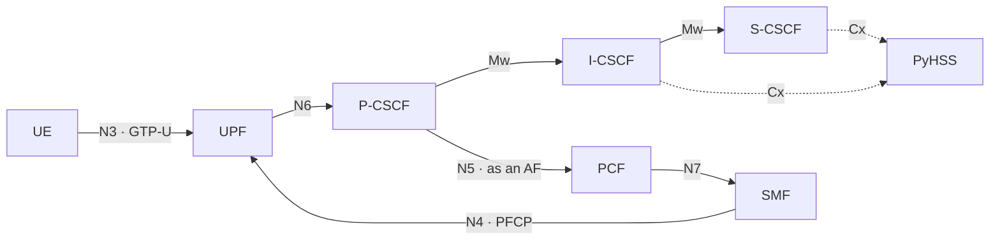
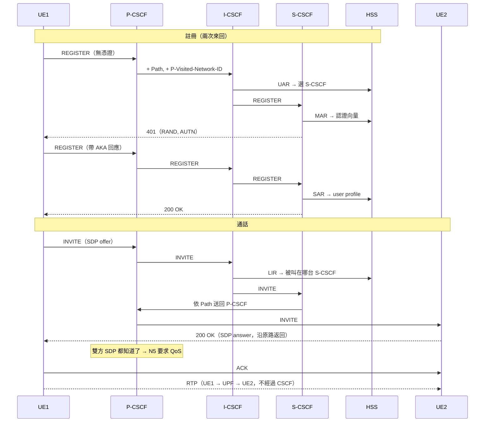
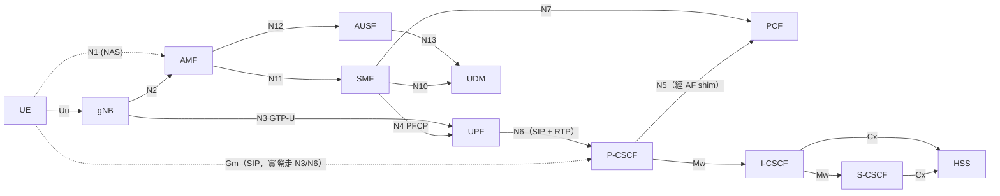

VoNR End-to-End Architecture
Sharing a simplified VoNR (Voice over New Radio) End-to-End Architecture covering the complete call path from UE → 5G RAN → 5G Core → IMS → terminating UE.
A useful reference for understanding how 5G NR, 5GC, SIP, and IMS work together to establish a voice call.



---

# 背景知識筆記

> 對照專案：`kamailio-free5gc/`（free5gc 4.2.3 + Kamailio 6.1.4 + PyHSS 2.0.0）
> 延伸閱讀：`kamailio-free5gc/docs/architecture.md`、`call-flows.md`、`identities.md`、`policy-and-qos.md`

## 1. IMS 是什麼？

**IMS（IP Multimedia Subsystem，IP 多媒體子系統）** 是 3GPP 定義的「營運商通話服務平台」。
4G 上的 VoLTE、5G 上的 VoNR，背後都是 IMS。

### 為什麼需要 IMS：5GC 不會打電話

5G 核心網（5GC）只負責「連線」：

| 5GC 做的事                                     | 由誰負責         |
| ---------------------------------------------- | ---------------- |
| 認證這台設備能不能上網（5G-AKA）               | AMF / AUSF / UDM |
| 分配 IP、建立 PDU session（一條 GTP-U tunnel） | SMF              |
| 轉送封包                                       | UPF              |
| 決定 QoS 政策                                  | PCF              |

但 5GC **不知道封包內容是什麼**，也不懂「打給 0912-xxx」這件事。
打一通電話還需要：

- **定址**：這個號碼現在在哪個 IP？（註冊 / location）
- **服務認證**：這個用戶有沒有權限用通話服務？
- **通話控制**：響鈴、接聽、掛斷、轉接、保留……
- **跟網路要 QoS**：語音需要低延遲、保證頻寬，和下載檔案不一樣

這些就是 IMS 的工作，它以 **SIP** 作為核心協定（見第 2 節）。

### IMS 和 5GC 的關係

- **對 5GC 來說**，IMS 只是 Data Network 上的一台普通 server，接在 UPF 的 N6 後面，地位跟 internet 上的網站差不多。
- **對 IMS 來說**，5GC 是一個「接取網路」：負責幫它送封包，必要時可以要求它給特定 QoS。
- 兩邊**各自有用戶資料庫、各自認證**：

  |            | 5G 端                            | IMS 端                                                                                                    |
  | ---------- | -------------------------------- | --------------------------------------------------------------------------------------------------------- |
  | 用戶資料庫 | UDR（透過 UDM 存取）             | HSS（本專案是 PyHSS）                                                                                     |
  | 身分       | SUPI（`imsi-208930000000001`） | IMPI（私有身分，類似帳號）/ IMPU（公開身分，`sip:...@ims.mnc093.mcc208.3gppnetwork.org`，類似電話號碼） |
  | 認證       | 5G-AKA                           | IMS AKA                                                                                                   |

  所以一支手機要打電話，得**先過 5G 認證拿到網路，再過 IMS 認證拿到通話服務**。HSS 和 UDR 之間沒有介面，只靠「開戶時從同一個 IMSI 推導出兩邊的身分」來保持一致（詳見 `docs/identities.md`）。
- 兩邊只有三個接點：

  | 接點          | 用途                                                 |
  | ------------- | ---------------------------------------------------- |
  | **N6**  | SIP 和 RTP 都走 PDU session，從 UPF 出去到達 IMS     |
  | **PCO** | 建立 PDU session 時，SMF 告訴 UE「你的 P-CSCF 在哪」 |
  | **N5**  | P-CSCF 以 AF 的身分向 PCF 要求 QoS                   |

## 2. SIP 是什麼？

**SIP（Session Initiation Protocol，RFC 3261）** 是用來**建立、修改、結束一段通訊 session** 的信令協定。

### 長得像 HTTP

SIP 是純文字協定，格式幾乎就是 HTTP：一行 request line，接著 headers，最後是 body。

```
INVITE sip:208930000000002@ims.mnc093.mcc208.3gppnetwork.org SIP/2.0
Via: SIP/2.0/UDP 10.62.0.1:5060;branch=z9hG4bK...
From: <sip:208930000000001@ims...>;tag=abc
To: <sip:208930000000002@ims...>
Call-ID: 12345@10.62.0.1
CSeq: 1 INVITE
Contact: <sip:208930000000001@10.62.0.1:5060>
Content-Type: application/sdp

v=0
c=IN IP4 10.62.0.1          ← 請把聲音送到這個 IP
m=audio 6000 RTP/AVP 0      ← 這個 port，codec 0 = G.711 PCMU
```

- **Request（method）**：`REGISTER`（登記我在哪）、`INVITE`（發起通話）、`ACK`、`BYE`（掛斷）、`CANCEL` 等
- **Response**：跟 HTTP 一樣是狀態碼，例如 `100 Trying`、`180 Ringing`、`200 OK`、`401 Unauthorized`、`404 Not Found`

### SIP 只負責「談」，不負責傳聲音

這是最重要的觀念，一通電話會用到三個協定：

| 協定                              | 角色                                   | 比喻                                   |
| --------------------------------- | -------------------------------------- | -------------------------------------- |
| **SIP**                     | 信令：誰打給誰、響鈴、接聽、掛斷       | 總機幫你轉接                           |
| **SDP**（放在 SIP body 裡） | 描述媒體：我的 IP/port、支援哪些 codec | 雙方交換「打到我哪支分機、講哪種語言」 |
| **RTP**                     | 真正的語音封包                         | 接通後兩人直接講話                     |

SIP 經過一連串 proxy（CSCF）轉送，但 **RTP 是兩端直接互送，不經過任何 CSCF**。

### 一通電話的基本流程

```
UE1                     (proxies)                    UE2
 |--- INVITE (SDP offer) ---------------------------->|
 |<-- 100 Trying                                      |
 |<-- 180 Ringing ------------------------------------|
 |<-- 200 OK (SDP answer) ----------------------------|
 |--- ACK ------------------------------------------->|
 |<========== RTP 語音（直接互送）====================>|
 |--- BYE ------------------------------------------->|
 |<-- 200 OK -----------------------------------------|
```

### 和 IMS 的關係

- IMS 裡的 SIP 是 **3GPP 擴充版**（TS 24.229），多了很多 `P-` 開頭的 header（例如 `P-Visited-Network-ID`），也多了 `Path`、`Service-Route` 等路由用的 header，認證則把 AKA 包在 HTTP Digest 裡。
- **Kamailio** 本身是一套開源 SIP server/proxy。本專案的三個 CSCF 都是 Kamailio，差別只在各自載入不同的 `ims_*` 模組、寫了不同的路由邏輯（`kamailio.cfg`）。

## 3. 那張 topo graph 的路線，跟一般路線差在哪？

README 那張圖：



（圖裡省略了 gNB，實際路徑是 UE → gNB → N3 → UPF。）

### 一般上網路線（`internet` DNN）

```
UE ─GTP-U→ gNB ─N3→ UPF ─N6→ NAT(MASQUERADE) → Internet server
```

- 一條 PDU session，所有流量擠在**預設 QoS flow**（本專案的訂閱資料中，`internet` 的 5QI 是 9，也就是 best effort）
- 出 UPF 後會做 NAT，外面看到的是 UPF 的位址
- 應用層（例如 YouTube）**不會回頭跟核心網溝通**，網路也不知道自己送的是什麼內容
- 單向：資料送出去就結束了

### IMS 路線的不同之處

| # | 差異                                 | 一般上網                         | IMS（這張圖）                                                                                                                                                                                         |
| - | ------------------------------------ | -------------------------------- | ----------------------------------------------------------------------------------------------------------------------------------------------------------------------------------------------------- |
| 1 | **DNN / PDU session**          | `internet`，10.60/16、10.61/16 | 專用的`ims` DNN，10.62/16；是另一條 tunnel、另一個 IP，預設 5QI 5（IMS signalling）                                                                                                                 |
| 2 | **N6 後面接什麼**              | Internet                         | P-CSCF。`corenet` 和 `dnnet` 兩個網段互不相通，UE **只能經過 UPF** 才到得了 IMS                                                                                                             |
| 3 | **NAT**                        | 有                               | **沒有**。`config/upf-n6.sh` 刻意不對 dnnet 做 masquerade，讓 CSCF 看到 UE 的真實 IP。原因有二：SIP 路由需要真實 IP；PCF 也是用 UE IP 把 QoS 綁到對的 PDU session                             |
| 4 | **目的地怎麼知道**             | DNS                              | 除了 DNS，UE 還在 PDU Session Establishment 的 PCO 裡要求 P-CSCF 位址，SMF 在 Accept 時回傳。這個位址不寫死在 UE 上（free-ran-ue 需要打`pcscf-discovery.patch` 才支援）                             |
| 5 | **信令和媒體分開走**           | 同一條路                         | SIP：UE1 → UPF → P → I → S → P → UPF → UE2。RTP：UE1 → UPF → UE2，在 UPF 內直接轉回另一條 tunnel（hairpin），**完全不經過 CSCF**                                                       |
| 6 | **應用層回頭改網路**（最關鍵） | 沒有                             | P-CSCF 看到 200 OK 時，雙方的 SDP 都已經確定，它就知道 RTP 的 5-tuple，於是走**N5 → PCF → N7 → SMF → N4 → UPF** 這條控制鏈，在 UPF 裝上新的 PDR 和 QER（5QI 1，conversational voice，GBR） |
| 7 | **兩種性質的線**               | —                               | 實線中，N3/N6/Mw 是封包或 SIP 實際流經的路徑；虛線 Cx 是 Diameter 查資料庫；N5/N7/N4 則是控制面的 HTTP/2 和 PFCP                                                                                      |

一句話總結：一般上網是「**網路送什麼都一視同仁**」；IMS 路線則是「**應用（IMS）知道這是通話，並回頭告訴網路要特別照顧這條流**」，而這個迴圈就是圖右半邊 P-CSCF → PCF → SMF → UPF 那一圈。

### 和商用 IMS 的差異（本專案刻意簡化的部分）

- 商用網路通常在 P-CSCF 旁邊放 **IMS-AGW / SBC**，把媒體錨定在那裡（用於 NAT traversal、隱藏拓撲、合法監聽、轉碼）；本專案讓 RTP 直接在 UPF 內轉送
- Kamailio 的 `ims_qos` 講的是 4G 的 **Rx**（Diameter），free5gc 的 PCF 只有 5G 的 **N5**（HTTP/2），所以中間多了一個 **AF shim**（`af/main.go`）做轉換，P-CSCF 透過 `http_client` 呼叫它
- 沒有 IPsec（UE 和 P-CSCF 之間的 Gm 介面，商用網路會建立 IPsec SA）
- free5gc 雖然會安裝 QoS 規則，但底層不會真的限速或保證頻寬，所以測試只驗證「規則有沒有裝進 gtp5g」

## 4. P-CSCF / I-CSCF / S-CSCF 在做什麼？

**CSCF = Call Session Control Function**，是三種不同角色的 SIP proxy/server。

比喻（到銀行辦事）：

| 角色             | 比喻                | 一句話                           |
| ---------------- | ------------------- | -------------------------------- |
| **P-CSCF** | 門口警衛 / 接待櫃台 | UE 唯一會直接接觸的 IMS 節點     |
| **I-CSCF** | 總機 / 詢問處       | 只回答「這個人歸哪位承辦人管？」 |
| **S-CSCF** | 你的專屬承辦人      | 真正負責認證、註冊、路由通話     |
| **HSS**    | 客戶資料檔案室      | 存身分、金鑰、用戶服務設定       |

### P-CSCF（Proxy-CSCF）：接取代理

- 位置：`pcscf/`，10.100.100.10:5060。模組：`ims_registrar_pcscf`、`ims_usrloc_pcscf`、`ims_dialog`、`path`、`sdpops`、`http_client`
- **是 UE 的第一個、也是唯一的接觸點**（Gm 介面），位址透過 PCO 得知
- **刻意保持簡單**：不存用戶資料，也不查 HSS
- 註冊時：
  - 加上 `Path` header，讓之後打給這個 UE 的來電也會繞回這台 P-CSCF。沒有它的話，被叫端那一段會直接略過 P-CSCF，P-CSCF 就看不到 SDP，也就無法要求 QoS
  - 加上 `P-Visited-Network-ID`，I-CSCF 查 HSS 時需要用到
  - 註冊成功後，記錄「這個 IMPU ↔ 這個 UE contact」的對應
- 通話時：**扮演 AF**，從 SDP 取出 RTP 位址和 port，經過 AF shim 走 N5 向 PCF 要求 QoS；掛斷時再釋放
- 本專案兩支 UE 共用同一台 P-CSCF，所以**一通電話會經過它兩次**（主叫端出去一次、被叫端進來一次），兩端各自預留一次 QoS

### I-CSCF（Interrogating-CSCF）：入口 / 查詢者

- 位置：`icscf/`，10.100.100.22:4060。模組：`ims_icscf`、`cdp`（Diameter）
- 是營運商 home network 的入口，**本身不保存狀態**，只負責詢問 HSS
- 用到兩種 Cx 查詢：
  - **UAR/UAA**（REGISTER 時）：「這個用戶該由哪台 S-CSCF 服務？」HSS 回覆 Server-Name
  - **LIR/LIA**（有來電時）：「被叫的人目前註冊在哪台 S-CSCF？」
- 拿到答案後，把 SIP request 轉給那台 S-CSCF
- 商用網路裡有很多台 S-CSCF，I-CSCF 負責分配負載和隱藏內部拓撲；本專案只有一台 S-CSCF，但仍然保留這個角色，讓 Cx 介面真的存在

### S-CSCF（Serving-CSCF）：服務節點，也是 IMS 的大腦

- 位置：`scscf/`，10.100.100.21:6060。模組：`ims_registrar_scscf`、`ims_usrloc_scscf`、`ims_auth`、`ims_dialog`、`cdp`
- **認證**：
  1. **MAR/MAA**：向 HSS 要 IMS AKA 認證向量（RAND、AUTN、XRES……）
  2. 回 `401 Unauthorized` 給 UE，帶上 RAND/AUTN 作為 challenge
  3. UE 第二次送 REGISTER 時帶上回應，S-CSCF 比對 XRES
- **註冊**：**SAR/SAA** 告訴 HSS「我現在負責服務這個用戶」，並取回 user profile；接著在自己的 registrar 記下 contact 和 `Path`
- **路由**：來電時，把被叫的 IMPU 解析成註冊時留下的 contact，再**沿著 `Path` 送回被叫端的 P-CSCF**
- 商用網路中，S-CSCF 還會依照 user profile 裡的 iFC（initial Filter Criteria）把請求轉給 Application Server（例如話中插接、轉接等補充服務）；本專案沒有 AS

### 四種 Cx（Diameter）指令一覽

| 指令                | 誰發出 | 問什麼                         | 什麼時候                       |
| ------------------- | ------ | ------------------------------ | ------------------------------ |
| **UAR / UAA** | I-CSCF | 這個用戶該由哪台 S-CSCF 服務？ | REGISTER（第一次）             |
| **MAR / MAA** | S-CSCF | 給我這個 IMPI 的認證向量       | REGISTER（第一次）             |
| **SAR / SAA** | S-CSCF | 我現在服務他了，給我 profile   | REGISTER（第二次，認證通過後） |
| **LIR / LIA** | I-CSCF | 被叫目前註冊在哪台 S-CSCF？    | INVITE（來電）                 |

`scripts/03-call-test.sh` 會檢查這四種指令是否都有被使用。

### 串起來：一次註冊加一通電話



## 5. VoNR 架構圖解讀（`VoNR_over_IMS_arch.jpg`）

這張圖把一通 VoNR 通話會用到的所有實體放在同一張畫面上。從左到右可以分成五塊：

```
[5G UE] ─Uu→ [NG-RAN: gNB] → [5GC: AMF/AUSF/UDM/SMF/UPF/PCF] → [IMS Core: CSCF/HSS/TAS/MRF] → [IMS 應用 / 外部網路]
```

### 5.1 各區塊在做什麼

**① 5G UE（最左）**

- 手機本身就是 **VoNR client**，上面同時跑好幾套協定：
  - 5G NAS：跟 AMF/SMF 溝通，負責註冊和建立 PDU session
  - IMS client + SIP stack：跟 P-CSCF 講 SIP
  - RTP/RTCP：傳送和監控語音
  - 支援 QoS（5QI）
- 在本專案中，對應 free-ran-ue 的 UE，加上在 UE container 裡、綁在 tunnel 介面上的 SIPp

**② 5G Access Network（NG-RAN）**

- **gNB** 就是基地台。空中介面是 **Uu**，往核心網有兩條線：
  - 控制面 **N2** 接 AMF
  - 使用者面 **N3**（GTP-U）接 UPF
- 在本專案中對應 free-ran-ue 的 gNB

**③ 5G Core Network（藍框）**

| NF         | 在 VoNR 裡的角色                                                 |
| ---------- | ---------------------------------------------------------------- |
| AMF        | 處理 UE 的註冊、移動性，轉送 NAS                                 |
| AUSF + UDM | 5G-AKA 認證、訂閱資料（包括「這個用戶能用`ims` DNN」）         |
| SMF        | 建立 IMS 專用的 PDU session，並在 PCO 裡告訴 UE 它的 P-CSCF 位址 |
| UPF        | 轉送 SIP 和 RTP 封包，執行 QoS 規則（PDR/QER）                   |
| PCF        | 接收 IMS 的 QoS 請求，轉成 PCC rule 交給 SMF                     |

**④ IMS Core（橘框）**

| 實體                                                                    | 角色                                                                                                                   | 本專案有嗎                       |
| ----------------------------------------------------------------------- | ---------------------------------------------------------------------------------------------------------------------- | -------------------------------- |
| P-CSCF / I-CSCF / S-CSCF                                                | SIP 信令的三段 proxy（見第 4 節）                                                                                      | ✅ 三個 Kamailio                 |
| HSS                                                                     | IMS 用戶資料：身分、profile、認證金鑰、目前註冊在哪                                                                    | ✅ PyHSS（和 UDR**分開**） |
| **TAS**（Telephony Application Server，也叫 MMTel AS）            | 補充服務：來電轉接、話中插接、保留、來電顯示等。S-CSCF 依照 user profile 裡的 iFC，透過**ISC** 介面把 SIP 轉給它 | ❌                               |
| **MRFC / MRFP**（Media Resource Function Controller / Processor） | 媒體資源：多方會議混音、語音提示（「您撥的號碼是空號」）、撥號音。MRFC 管控制，MRFP 實際處理媒體                       | ❌                               |

**⑤ 右側：IMS 應用與外部網路**

- **IMS Applications**：語音、視訊、IMS 簡訊、語音信箱、會議等服務，大多由各種 AS 加上 MRF 組合出來
- **External Networks**，用來和傳統電話網路（PSTN）互通：

  | 實體                                      | 角色                                |
  | ----------------------------------------- | ----------------------------------- |
  | BGCF（Breakout Gateway Control Function） | 決定這通電話要在哪裡「出口」到 PSTN |
  | MGCF（Media Gateway Control Function）    | 信令轉換：SIP ↔ ISUP/BICC          |
  | MGW（Media Gateway）                      | 媒體轉換：RTP ↔ TDM 電路語音       |

  本專案只有 IMS 用戶互打，沒有這一塊。

**⑥ 底部兩條長線**

- **Control Plane（SIP Signaling）**，藍色虛線：SIP 從 UE 一路到 IMS
- **Media Plane（RTP/RTCP）**，綠色實線：語音從 UE 一路到對端或 MGW

### 5.2 沿著圖走一遍：一通 VoNR 通話的四個階段

1. **上網**：UE 透過 gNB 接到 AMF，由 AUSF/UDM 完成 5G-AKA 認證
2. **建立 IMS PDU session**：SMF 建立 `ims` DNN 的 session，在 UPF 上安裝規則，並透過 PCO 告訴 UE P-CSCF 的位址（預設 QoS flow 用 5QI 5，也就是 IMS signalling）
3. **IMS 註冊**：SIP REGISTER 經過 UPF 到 P-CSCF → I-CSCF → S-CSCF，由 HSS 提供資料完成 IMS AKA（第 4 節的流程）
4. **通話**：
   - INVITE 經 CSCF 路由到對方（有補充服務的話，S-CSCF 會先經 ISC 轉給 TAS）
   - 接通後，P-CSCF 向 PCF 要求 QoS，一路下到 UPF 和 gNB，建立 **5QI 1**（conversational voice，GBR）的專用 QoS flow
   - RTP 走 media plane；若對方是市話，則經 MGCF/MGW 轉進 PSTN

### 5.3 ⚠️ 這張圖的錯誤與容易誤解的地方

這張圖適合用來建立「有哪些角色」的整體印象，但**不少介面名稱標錯了**，不要拿它當規格來背。對照 3GPP TS 23.501 和 TS 23.228：

| 圖上的說法                                                  | 正確說法                                                                                                                                                                                                                       |
| ----------------------------------------------------------- | ------------------------------------------------------------------------------------------------------------------------------------------------------------------------------------------------------------------------------ |
| **N13**：AUSF ↔ SMF                                  | N13 是**AUSF ↔ UDM**。SMF 和 AUSF 之間沒有介面                                                                                                                                                                          |
| **N10**：UDM ↔ AUSF                                  | N10 是**SMF ↔ UDM**（AMF ↔ UDM 則是 N8）                                                                                                                                                                               |
| **N15**：SMF ↔ PCF                                   | N15 是**AMF ↔ PCF**；**SMF ↔ PCF 是 N7**                                                                                                                                                                         |
| **N7** 畫在 UDM 和 SMF 之間                           | N7 是 SMF ↔ PCF                                                                                                                                                                                                               |
| **Mi**：I-CSCF ↔ S-CSCF                              | I-CSCF ↔ S-CSCF 是**Mw**；Mi 是 CSCF ↔ BGCF                                                                                                                                                                            |
| **ISC** 畫在 P-CSCF ↔ S-CSCF 上方、以及 UDM/PCF 附近 | ISC**只存在於 S-CSCF ↔ AS（TAS）之間**                                                                                                                                                                                  |
| **My**：MRFC ↔ MRFP                                  | 應該是**Mp**（H.248），沒有 My 這個介面                                                                                                                                                                                  |
| **Mr**：TAS ↔ MRFC                                   | S-CSCF ↔ MRFC 才是 Mr；AS ↔ MRFC 是**Mr'**                                                                                                                                                                             |
| **Cx**：S-CSCF ↔ HSS/UDR                             | **I-CSCF 和 S-CSCF** 都會走 Cx 到 HSS（I-CSCF 用 UAR/LIR）                                                                                                                                                               |
| **HSS/UDR** 畫成同一顆資料庫                          | 標準上可以把 HSS 和 UDM 合設（HSS+UDM），但兩者仍是不同的功能。本專案刻意讓 PyHSS 和 UDR 完全分開，兩者之間沒有任何介面                                                                                                        |
| **缺少 N5（或 Rx）**                                  | 這是 IMS 和 5GC 之間**最關鍵的一條線**：P-CSCF（以 AF 身分）↔ PCF，用來要求語音 QoS。圖上完全沒畫，只在 Key Points 提到「PCF + UPF 執行 QoS」                                                                           |
| **缺少 N6**                                           | 圖上的 SIP 和 RTP 長線從 gNB 直接連到 IMS 和 MGW，**看起來像繞過了 UPF**。實際上 SIP 和 RTP 對 5GC 而言都只是使用者面的封包，**一定要走 N3 → UPF → N6** 才能到 IMS。本專案用兩個互不相通的網段，確保一定經過 UPF |
| QoS「由 PCF + UPF 執行」                                    | PCF 只負責**決策**；執行的是 UPF（封包分類、QER），以及 gNB（無線資源排程，GBR 真正的保證在這裡）。另外，free5gc 的 UPF 雖然會裝上 QER，但實際上不會限速                                                                 |
| 沒畫 N1、Gm                                                 | N1 是 UE ↔ AMF 的 NAS（邏輯介面，實體上經 gNB 轉送）；Gm 是 UE ↔ P-CSCF 的 SIP                                                                                                                                               |

### 5.4 修正後的核心介面（本專案實際用到的）



圖中的 **TAS、MRFC/MRFP、BGCF/MGCF/MGW** 本專案都沒有。專案範圍只到「兩個 IMS 用戶互打，並驗證 5GC ↔ IMS 的三個接點（N6、PCO、N5）」。若之後要擴充，順序大概會是：加 TAS 做補充服務 → 加 MRF 做會議或語音提示 → 加 PSTN 閘道。
