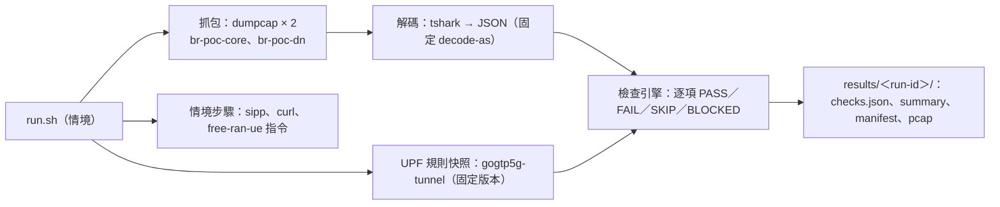
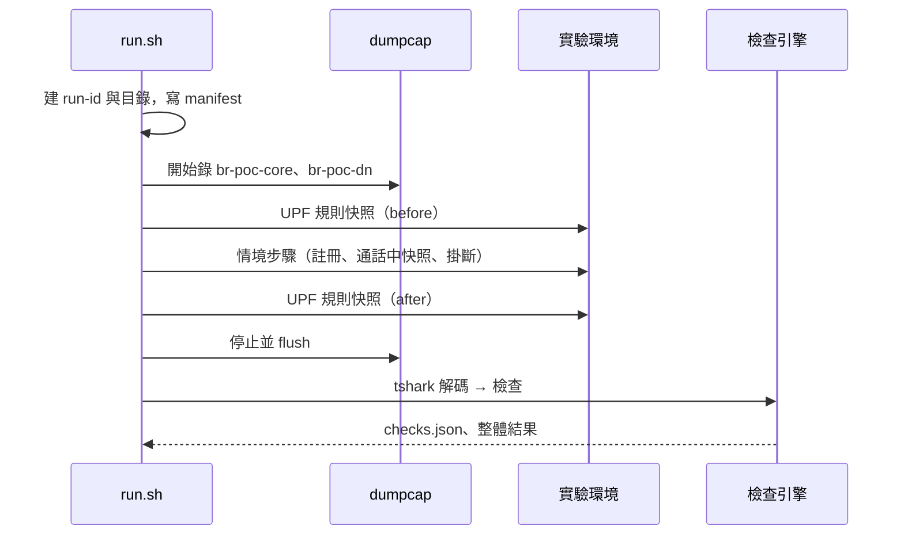

# 抓包版端到端測試（W1）設計文件

| 項目 | 內容 |
|---|---|
| 版本／狀態 | v0.1／設計審查中（2026-10-22） |
| 作者 | 見 git log |
| 審查者 | TBD |
| 範圍 | W1：把 `03-call-test.sh`、`05-n5-qos-test.sh` 改成以抓包與 UPF 規則快照判定；提供其他規格組（rx-n5、hss-udm、smf-n1n2）的 L1～L3 判定所需的共用機制 |
| 相關文件 | [interface-spec.md](interface-spec.md)、[test-plan.md](test-plan.md)、[adr/](adr/)、總計畫 [vonr-ims-nf-plan.md](../overview/vonr-ims-nf-plan.md) W1 |

## 1. 摘要

在 host 的兩個 docker bridge（`br-poc-core`、`br-poc-dn`）上，每次測試都錄一份新的 pcap，用 tshark 解出 NGAP／NAS、GTP-U 內層的 SIP 與 RTP、PFCP、SBI（HTTP/2 cleartext）、Diameter（Cx、Rx），再用 gtp5g netlink 的 UPF 規則快照補上封包裡看不到的 PDR／QER。判定由一組「檢查」組成，每個檢查對應到其他規格組的需求編號，結果只有 PASS、FAIL、SKIP、BLOCKED 四種，SKIP 與 BLOCKED 永遠不算 PASS。不改 Kamailio、free5gc 的 log 格式，也不再依賴它們。

## 2. 背景與動機

| 缺口（讀 `scripts/03-call-test.sh`、`05-n5-qos-test.sh` 得到） | 後果 |
|---|---|
| 最後判定只看 sipp 退出碼、GTP-U 封包數、BYE 計數、LIR 計數；UAR／MAR／SAR、三個 CSCF 的路徑、註冊結果、SIP-in-GTP 都只印出來 | 註冊失敗或 Cx 少一步也可能 PASS |
| LIR 計數與 BYE 計數來自 Kamailio 的 `xlog` 字串（icscf cfg L151、pcscf cfg L95 等） | W3／W4／W8 換掉元件或改 cfg 後，測試會失效或誤判 |
| QoS 檢查找不到 gtp5g 讀取工具時結果是 SKIP，但不影響 PASS | 「QoS 規則存在」沒被證明也會 PASS |
| SIP-in-GTP 用 `tcpdump -A | grep -c` 數純文字；RTP 用「最大的同長度封包群」猜 | 不能分辨方向、不能對應到哪一通電話 |
| 註冊的 sipp 結果經過 `tail -3`，退出碼沒被檢查 | 註冊失敗不會讓測試失敗 |
| `gogtp5g-tunnel` 用 `go install …@latest` 臨時安裝 | 工具版本不固定 |

## 3. 目標與非目標

**目標**

1. 在**現有部署**（PyHSS＋AF shim）上，抓包版測試能判定現在的行為：註冊、Cx 四種指令、通話建立與結束、SIP 與 RTP 確實經過 N3、通話中 UPF 有語音規則、通話後規則消失。
2. 同一套機制能在 W3、W4、W5、W8 之後，加上各規格組的檢查（Rx、N5、NGAP Modify、ASR 等），不必重寫。
3. 每次執行留下完整證據：pcap、UPF 規則快照、版本 manifest、逐項結果（JSON）、摘要。
4. 判定規則明確：SKIP、BLOCKED 不算 PASS；必須的檢查缺一不可。

**非目標**

| 非目標 | 為什麼這次不做 | 何時做 |
|---|---|---|
| 解密 NAS（NEA1/2/3） | 部署用 NEA0（`config/amfcfg.yaml`），不需要 | 部署改用加密時 |
| 解密 SBI TLS | 部署用 h2c | 同上 |
| 量測語音品質（延遲、丟包、MOS） | 屬 L5 | 後續 |
| 自動跑在 CI | 需要 gtp5g 與 self-hosted runner | [vonr-ims-dev-process.md](../overview/vonr-ims-dev-process.md) §4.4 |
| 容器內抓包 | host bridge 已看得到所有需要的流量 | 不排定 |

## 4. 一個例子

一次 `call` 情境：開始錄兩個 bridge → 兩支 UE 註冊 → 打一通電話 → 掛斷 → 停止錄製 → 依情境的檢查清單逐項判定。判定「UE1 的 IMS 註冊成功」的方式，不再是 grep `is registered`，而是在 `br-poc-core` 的 GTP-U 內層找到 UE1 發出的 REGISTER，以及 P-CSCF 回給 UE1 的 `200 OK`（同一個 Call-ID）。

## 5. 設計

### 5.1 架構與責任



| 元件 | 負責 | 不負責 |
|---|---|---|
| 情境（scenario） | 準備、執行步驟、標記時間點、決定這次要跑哪些檢查 | 判定 |
| 抓包 | 每次執行重新錄，限定時間窗 | 解碼 |
| 解碼 | 用固定的 decode-as 把封包轉成欄位 | 判定 |
| 檢查引擎 | 依檢查定義算出結果與證據指標（frame number、規則 ID） | 執行步驟 |
| 檢查定義 | 每個檢查的條件、適用的工作項、對應的需求編號 | — |

### 5.2 抓包點與看得到什麼

| 位置 | 看得到 | 看不到 |
|---|---|---|
| `br-poc-core` | NGAP／NAS（SCTP 38412）、N3 GTP-U 2152（內層的 SIP 與 RTP）、PFCP 8805、SBI h2c 8000（Npcf、Nudm、Nsmf、Namf） | — |
| `br-poc-dn` | N6 解封後的 SIP（UE↔P-CSCF）、CSCF 之間的 SIP、Diameter（Cx 3868；W3 之後的 Rx）、P-CSCF → AF shim 的 HTTP 8090 | UE↔UE 的 RTP（在 UPF 內轉送，不經過 N6） |
| UPF netns（gtp5g netlink） | PDR、FAR、QER | 封包 |

### 5.3 結果模型

| 結果 | 意思 | 算不算 PASS |
|---|---|---|
| PASS | 條件成立，有證據指標 | 是 |
| FAIL | 條件不成立 | 否 |
| SKIP | 這次情境刻意不跑（例如工作項還沒做） | 否 |
| BLOCKED | 想跑但跑不了（工具缺、抓包失敗、前置失敗） | 否 |

整體結果：必須的檢查全部 PASS 才是 PASS；有 FAIL 就是 FAIL；否則是 INCOMPLETE（[ADR-0002](adr/0002-skip-and-blocked-never-pass.md)）。

### 5.4 時序



逾時：任一步驟超過情境設定的上限就中止，已錄的 pcap 仍保存，依賴該步驟的檢查標 BLOCKED。

### 5.5 程式結構

```
kamailio-free5gc/scripts/e2e/
├── run.sh                 # 入口：run.sh <scenario> [--with W3a,W4,...]
├── lib/capture.sh         # dumpcap 起停
├── lib/upf-rules.sh       # gogtp5g-tunnel 快照（固定版本）
├── decode/                # tshark 參數與 decode-as 設定
├── checks/                # 檢查定義（YAML）＋判定程式（Python，用 python3 -I 執行）
└── scenarios/             # call、n5-qos、release-pdu-session、re-invite、register-only
```

`03-call-test.sh`、`05-n5-qos-test.sh` 保留為呼叫 `run.sh call`、`run.sh n5-qos` 的薄包裝，舊的 log grep 移除。

## 6. 考慮過的替代方案

| 方案 | 做法 | 優點 | 缺點 | 結論 |
|---|---|---|---|---|
| A. 維持 log grep，只補判定 | 把印出來的檢查改成判定 | 改動最小 | 換元件就失效；W3、W4、W8 都會改 log | 不採用 |
| B. 每個容器內 tcpdump | 在 CSCF、gnb 內錄 | 每個節點的視角 | free5gc 映像不一定有 tcpdump；多份 pcap 時間對不齊 | 不採用 |
| C. host bridge＋tshark（本設計） | 兩份 pcap、統一解碼 | 不改容器；看得到所有介面；時間一致 | UE↔UE 的 RTP 只能從 N3 看 | **採用**（[ADR-0001](adr/0001-capture-on-host-bridges.md)） |
| D. 用 Wireshark 的 dissector 寫自動化以外的工具（例如 sngrep） | 互動式 | 好除錯 | 不能自動判定 | 只當除錯工具 |

## 7. 跨面向考量

### 7.1 安全

| 威脅 | 對策 | 需求 |
|---|---|---|
| pcap 含 K、OPc 衍生資料、IMSI | results 目錄不進 git；分享前遮蔽 | REQ-EV-04 |
| 抓包需要 root | 只對兩個 bridge 開 capabilities（dumpcap） | REQ-CAP-01 |

### 7.2 可觀測性

每個檢查的結果都帶證據指標（pcap 檔名＋frame number，或規則 ID），可以直接在 Wireshark 開到那一格。

### 7.3 維運

結果目錄依 run-id 保存；提供清理指令只刪 30 天以前的結果。

## 8. 非功能需求

| 項目 | 提案值 | 依據 |
|---|---|---|
| 一次 `call` 情境總時間 | < 3 分鐘 | 現行 03 的 tcpdump 上限 120 秒 |
| 檢查引擎的結果可重現 | 同一份 pcap 重跑結果相同 | 判定必須只依賴 pcap 與快照 |

## 9. 假設、依賴與風險

**假設**：host 有 tshark（4.7.3）、dumpcap、gtp5g 0.10.2；NAS 為 NEA0；SBI 為 h2c。

| 風險 | 影響 | 可能性 | 對策 | 何時驗證 |
|---|---|---|---|---|
| tshark 對 h2c（無 TLS 的 HTTP/2）需要手動 decode-as，且要從連線開頭錄起才解得出 header（HPACK） | SBI 檢查全部 BLOCKED | 中 | 在環境啟動前就開始錄，或接受 SBI 檢查只在完整錄到連線時有效（D02） | G1 |
| Diameter 的 port 與 dissector 對應（Cx、Rx 都在 3868） | Cx／Rx 檢查失敗 | 低 | 固定 decode-as；用 Application-Id 分辨 | G1 |
| 現有部署沒有 `poc/*` 映像、容器沒在跑 | 無法先在現況驗證 | 已知 | G0 先跑 `01-up.sh` 重建 | G0 |
| gogtp5g-tunnel 版本與 gtp5g 0.10.2 不相容 | UPF 規則檢查 BLOCKED | 低 | 固定版本並記入 manifest（D03） | G1 |

## 10. 參考過的作法

| 來源 | 借鏡什麼 |
|---|---|
| 現行 `03-call-test.sh` | 前置檢查（UE IP、PCO 的 P-CSCF、UE 設定檔沒寫死 P-CSCF）、gtp5g 快照的 Python 判定 |
| free5gc `test_ci.sh`（主 repo） | 在 network namespace 裡跑整合測試的方式 |

## 11. 宣稱範圍與限制

能宣稱：「在本實驗環境中，以抓包與 UPF 規則快照判定的端到端測試通過」。不能宣稱：語音品質、加密環境下的行為、真實 RAN／UE。本組文件的「**必須**」是本專案對測試工具的要求。

## 12. 待解問題

| # | 問題 | 關閉條件 | 負責 | 期限 |
|---|---|---|---|---|
| D01 | 抓包權限：用 dumpcap capabilities 還是 sudo | 決定並寫進 README | TBD | G1 |
| D02 | tshark 解 h2c 的條件（是否必須錄到連線起點；需要哪些 decode-as） | 在現有部署實測 | TBD | G1 |
| D03 | gogtp5g-tunnel 的固定版本 | 選定與 gtp5g 0.10.2 相容的 commit | TBD | G1 |
| D04 | 檢查定義用 YAML＋Python，或全部用 Python | 決定 | TBD | G1 |

## 13. 後續階段

| 階段 | 內容 |
|---|---|
| L5 | 加入 RTP 的延遲、丟包統計（tshark `rtp,streams`） |
| CI | 移到 self-hosted runner |
