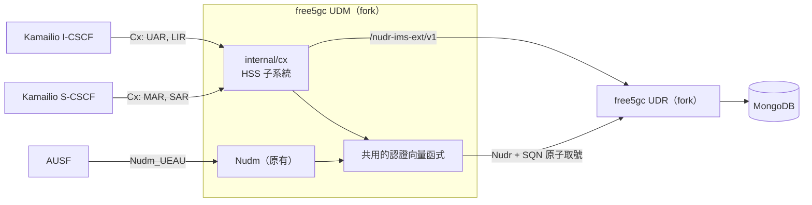
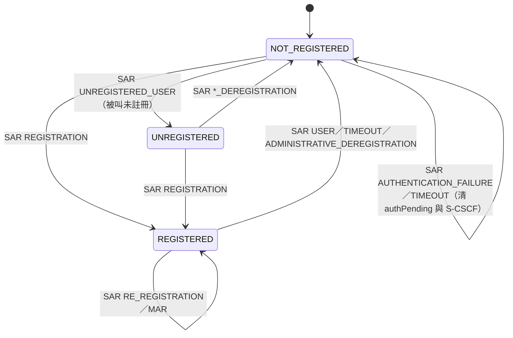
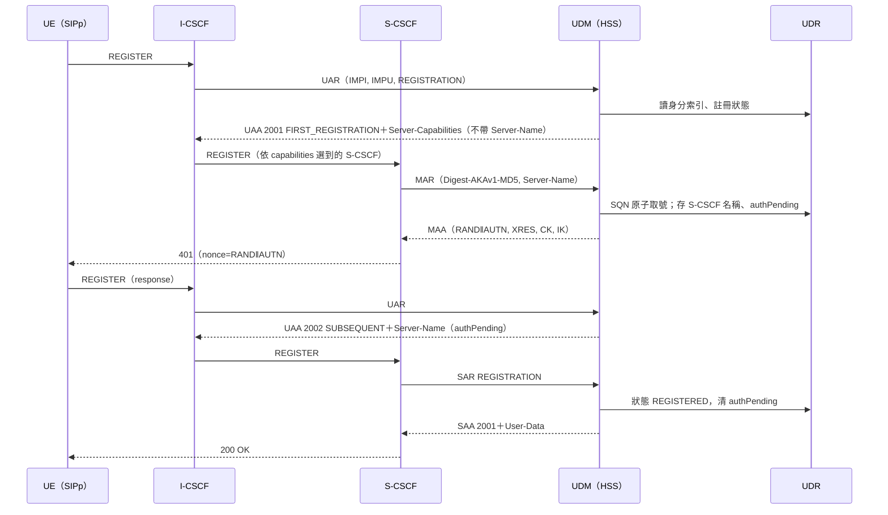
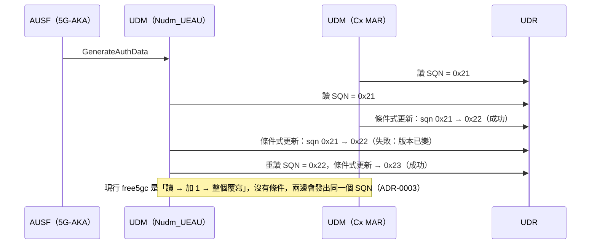
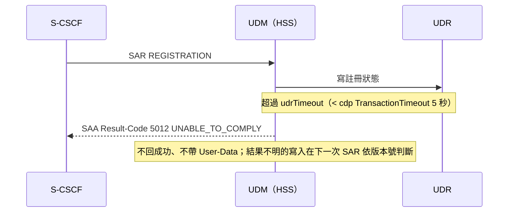
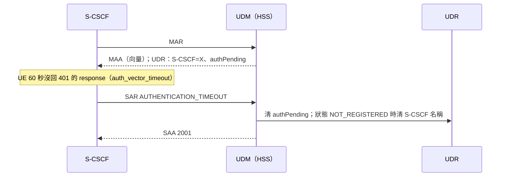

# HSS 併入 UDM 設計文件

| 項目 | 內容 |
|---|---|
| 版本／狀態 | v0.3／設計審查中（2026-10-22：加入 W8b） |
| 作者 | 見 git log |
| 審查者 | TBD |
| 範圍 | W8a（以 UDM 取代 PyHSS）＋W8b（RTR、PPR）；N70 等後續工作見 §13 |
| 相關文件 | [explained.md](explained.md)、[interface-spec.md](interface-spec.md)、[test-plan.md](test-plan.md)、[adr/](adr/)、總計畫 [vonr-ims-nf-plan.md](../overview/vonr-ims-nf-plan.md) W8 |

## 1. 摘要

在 free5gc UDM 裡加一個 HSS 子系統，對 Kamailio 的 I-CSCF、S-CSCF 提供 **Cx**（UAR、MAR、SAR、LIR），取代 PyHSS。IMS 用戶資料與註冊狀態存在 UDR 的非標準擴充；IMS AKA 與 5G-AKA 共用同一組 K／OPc／SQN，這也是 TS 33.203 §8.2 對 USIM 做 IMS 存取的要求。W8b 再加上 HSS 主動通知：刪除開戶資料、管理操作、S-CSCF 更換時送 RTR，profile 改變時送 PPR（UDM 以 Diameter client 角色，目的地是 S-CSCF 的 Origin-Host）。不做 N70、Sh 與 IMS restoration。

最大的取捨有兩個：
- **為了相容 Kamailio，選了 Cx 而不是 5GS 的服務化介面（N70）**，代價是要 fork UDM 與 UDR。
- **共用 SQN 之後，SQN 取號必須改成原子操作**，連帶要改 UDM 現有的 5G-AKA 路徑。

## 2. 背景與動機

| 缺口 | 後果 |
|---|---|
| IMS 用戶資料在 PyHSS（SQLite），5G 用戶資料在 UDR，兩邊靠開戶腳本對齊 | 任一邊漏改就會出現「5G 註冊成功、IMS 認證失敗」，而且錯誤要到 AUTN MAC 失敗時才看得出來（`kamailio-free5gc/docs/identities.md`） |
| 兩邊各有一個 SQN | 跟 TS 33.203 §8.2 不符：用 USIM 做 IMS 存取時，authentication key、演算法與 SQN 檢查機制都必須共用。真的手機上，兩邊交替認證會頻繁觸發重新同步 |
| PyHSS 有 4 個容器（hss、api、diameter、redis），而且映像只用 `latest@digest` 固定 | 多一套要維運、要除錯的系統；行為只能抓包觀察，本機沒有原始碼 |
| 5GC 不知道 IMS 註冊狀態 | 之後要做 IMS 註冊狀態與 5GC 的連動（例如 T-ADS）時，資料不在 5GC |

## 3. 目標與非目標

**目標（W8a）**

1. I-CSCF、S-CSCF 改連 UDM 後，`03-call-test.sh` 的 IMS 註冊與通話照樣通過，抓包看得到 UAR／MAR／SAR／LIR 由 UDM 回應。
2. 每個 Cx 指令的處理符合 TS 29.228 §6.1.1.1、§6.1.2.1、§6.1.4.1、§6.3.1 中本專案支援的分支；不支援的分支明確回失敗（[interface-spec.md](interface-spec.md) §3）。
3. 每個 SUPI 只有一個 SQN，5G-AKA 與 IMS AKA 都從它原子取號；並行時不會發出相同的 SQN。
4. IMS 用戶資料與註冊狀態存在 UDR；UDM 重啟不會遺失註冊狀態。
5. PyHSS 移除，並有可以切回 PyHSS 的回退程序。
6. HSS 子系統關閉時，UDM 的 Nudm 行為與未修改的 UDM 相同（5G 註冊回歸測試通過）。

**目標（W8b）**

7. 刪除開戶資料或管理操作解除註冊時，S-CSCF 收到 RTR，之後對該用戶的來電 LIR 回「未註冊」。
8. 修改開戶資料時，已註冊用戶的 S-CSCF 收到 PPR，User-Data 是新的內容；改不動時依 TS 29.228 §6.2.2.1 改送 RTR。

**非目標**（合理可能被當成目標，但這次刻意不做）

| 非目標 | 為什麼這次不做 | 何時做 |
|---|---|---|
| N70（Nhss_ImsUECM／SDM／UEAU，TS 29.562） | Kamailio 只支援 Cx；做了也沒有 consumer | Kamailio 或其他 CSCF 支援 N70 時，在同一個子系統加 SBI producer（§6 方案 A） |
| IMS restoration（TS 23.380）、P-CSCF restoration | 需要 S-CSCF 也支援；實驗只有一台 S-CSCF | 不排定 |
| Shared Public User Identity、一個 IMPU 對多個 IMPI、implicit registration set、wildcarded IMPU、PSI | 實驗的開戶規則是一個 IMSI 一個 IMPI 一個 IMPU | 有多裝置情境時 |
| SIP Digest、NASS-Bundled、GIBA 認證 | 實驗只用 IMS AKA（`registration_default_algorithm AKAv1-MD5`） | 不排定 |
| 漫遊（Visited-Network 檢查） | 只有 home network | 不排定 |
| IMS emergency registration | 沒有 E-CSCF | 不排定 |
| iFC 與 AS（ISC、Sh、N71） | 沒有 AS | 有 TAS 時 |
| IMS domain 專屬的 IND 範圍（TS 33.203 附錄 G 的建議） | free5gc 現在每組向量 +1，等於 IND 循環配置（TS 33.102 C.3.4 一般規則），已能容忍交錯；專屬範圍會改到 5G-AKA 行為 | 依 D07 結論 |
| 開戶整合進 free5gc webconsole | 先用腳本呼叫 UDR 擴充 API 就能驗收 | 依 D11 |
| 發 PR 回 free5gc 上游 | Cx 與非標準 UDR 擴充不符合上游方向 | 不排定 |

## 4. 一個例子

[explained.md](explained.md) 用「UE1 開機 → 5G 註冊 → IMS 註冊 → UE2 打給 UE1 → 掛斷 → 解除註冊」走一遍，並標出每一步 UDR 裡的 SQN 與註冊狀態怎麼變。第一次讀建議先看那份。

## 5. 設計

### 5.1 架構與責任



| 元件 | 負責 | 不負責 |
|---|---|---|
| `internal/cx`（UDM 內） | Diameter peer；UAR／MAR／SAR／LIR 的檢查與回應；組 User-Data XML | SIP；挑選 S-CSCF（只回 capabilities）；存資料 |
| 共用認證向量函式（UDM 內） | 取號、重新同步、Milenage；5G-AKA 與 IMS AKA 共用 | 5G 的 K_AUSF 推導（留在原本的 5G-AKA 路徑） |
| UDR 擴充 | IMS 用戶資料、身分索引、註冊狀態的 CRUD；SQN 原子取號 | 業務邏輯（狀態轉移在 UDM 判斷） |
| Kamailio I-CSCF | 依 UAA 的 Server-Name 或 capabilities 選 S-CSCF（`icscf/seed.sql`） | — |
| Kamailio S-CSCF | IMS AKA challenge、registrar、依 SAA 的 profile 服務用戶 | — |
| 開戶腳本 | 寫 5G 資料（現有 `02-`）與 IMS 資料（改寫 `04-`） | — |

### 5.2 資料模型與不變量

IMS 資料放在 UDR 的獨立前綴 `/nudr-ims-ext/v1`（[ADR-0004](adr/0004-ims-data-in-udr-extension.md)）。身分對應一律查開戶時寫入的索引（[ADR-0005](adr/0005-explicit-identity-mapping.md)）。

| 資料 | 內容 | 誰寫 |
|---|---|---|
| IMS subscription（每個 SUPI 一筆） | IMPI、IMPU、MSISDN、BarringIndication、service profile | 開戶 |
| 身分索引 | IMPI → SUPI、canonical IMPU → SUPI | UDR 在寫 IMS subscription 時同步維護 |
| 註冊狀態（每個 IMPU 一筆） | 狀態、S-CSCF 名稱、authentication pending、版本號 | UDM（Cx） |
| 認證資料 | K、OPc、AMF、SQN（原有的 `authenticationSubscription`） | 開戶；SQN 由 UDM 取號 |

不變量：

- **I1** 每個 SUPI 只有一個 SQN；5G-AKA 與 IMS AKA 發出的每組向量的 SQN 都不同。
- **I2** 每個 IMPU 只屬於一個 IMPI、一個 SUPI（第一階段）。
- **I3** 狀態是 NOT_REGISTERED 且 authentication pending 未設時，不保存 S-CSCF 名稱；W8a 不使用 `*_STORE_SERVER_NAME`，例外只在 [interface-spec.md](interface-spec.md) §9 的轉移表裡定義。
- **I4** Cx 回成功之前，對應的 UDR 寫入已經完成（REQ-GEN-05）。
- **I5** HSS 子系統不保存任何只存在記憶體、重啟就會遺失的業務狀態。

### 5.3 狀態機

每個 IMPU 的註冊狀態依 TS 29.228 的三種狀態，加上 authentication pending 旗標與 S-CSCF 名稱：



完整轉移表（每個狀態 × 每個事件，含 UDR 失敗、重啟、並行、開戶資料被刪）見 [interface-spec.md](interface-spec.md) §9。幾個非直覺的列：

- **MAR 不改變註冊狀態**，只存 S-CSCF 名稱並設 authPending（TS 29.228 §6.3.1 步驟 5）。這是 I-CSCF 在認證進行中再收到 REGISTER 時，UAR 能回同一個 S-CSCF 的依據（§6.1.1.1 步驟 6）。
- **認證失敗或逾時要清掉 S-CSCF 名稱**（SAR AUTHENTICATION_FAILURE／TIMEOUT，§6.1.2.1）。不清的話，這個 IMPU 會一直被導到同一台 S-CSCF，而且 I3 不成立。S-CSCF 的 `auth_vector_timeout` 是 60 秒（`scscf/kamailio.cfg`），所以這條路徑在實驗中會真的發生。

### 5.4 時序

**正常流程：IMS 註冊（第一次）**



**最危險的競態：5G-AKA 與 IMS AKA 同時取號**



**逾時一：UDR 沒有回應**



**逾時二：認證逾時，S-CSCF 送 AUTHENTICATION_TIMEOUT**



### 5.5 程式結構

照 free5gc CHF 放 Diameter 的方式：字典寫成 Go 字串（`chf/ccs_diameter/dict/dictionary.go`），啟動時以 `dict.Default.Load()` 載入，再用 `sm.New()` 建 state machine（`chf/pkg/abmf/abmf.go`）。CHF 用的是 `github.com/fiorix/go-diameter v3.0.2+incompatible`，內建字典只有 base、credit control、NAS、Ro／Rf、S6a，**沒有 Cx**，所以 Cx 字典要自己寫（版本選擇見 D13）。

```
udm/
├── pkg/factory/config.go        # 新增 cx 區塊（interface-spec §11）
├── pkg/service/init.go          # cx.enable 時啟動 cx.Server
└── internal/
    ├── cx/                      # HSS 子系統
    │   ├── dict/dictionary.go   # Cx 字典，只列 interface-spec 附錄 C 的 AVP
    │   ├── server.go            # peer 白名單、CER/DWR/DPR、依 command code 分派
    │   ├── uar.go  mar.go  sar.go  lir.go
    │   ├── statemachine.go      # interface-spec §9 的轉移表，純函式
    │   ├── userdata.go          # User-Data XML
    │   └── *_test.go
    ├── auth/                    # 共用認證向量：取號、resync、Milenage（從 sbi/processor/generate_auth_data.go 抽出）
    └── sbi/consumer/udr_ims.go  # /nudr-ims-ext/v1 client
udr/
└── internal/sbi/ims_ext/        # 擴充端點與 SQN 原子取號
```

`statemachine.go` 不碰網路與資料庫：輸入「目前紀錄＋事件」，輸出「答案＋新紀錄」。這讓轉移表可以逐列做表格驅動測試。

### 5.6 部署

| 項目 | 改法 |
|---|---|
| UDM 容器 | 自己 build；同時接 corenet（SBI）與 dnnet（Cx）；在 dnnet 取別名 `hss.ims.mnc093.mcc208.3gppnetwork.org`，沿用 PyHSS 的 Diameter 身分（[ADR-0001](adr/0001-hss-in-udm-over-cx.md)） |
| UDR 容器 | 自己 build（擴充端點） |
| Kamailio | `icscf.xml`、`scscf.xml` 不改；DNS 別名指到 UDM 即可。HSS 與 Rx／N5 Adapter 都在 dnnet 用 3868，IP 不同 |
| PyHSS | 移除 4 個容器與 `hss/pyhss.env`；回退程序保留（REQ-OPS-02） |
| 開戶 | `04-add-ims-subscribers.sh` 改呼叫 UDR 擴充 API；`02-` 不變 |

## 6. 考慮過的替代方案

| 方案 | 做法 | 優點 | 缺點 | 結論 |
|---|---|---|---|---|
| A. 獨立 SBI HSS，提供 N70（Nhss_ims），與 UDM 依 TS 23.632／29.563 互通 | 5GS 的服務化 HSS | **最接近 5GS 標準**；不用 fork UDM | Kamailio 只支援 Cx，沒有 consumer；TS 29.563 本機沒有，互通細節未核對 | 不採用。之後要走過去：在 `internal/cx` 旁加 Nhss_ims producer，共用同一份資料與狀態機 |
| B. 維持 PyHSS，只統一開戶 | 一支腳本同時寫 UDR 與 PyHSS | 1–2 天；不改 free5gc | SQN 仍是兩份，不符 TS 33.203 §8.2 | 不採用（使用者已選 B 計畫） |
| C. 獨立的 Cx HSS 程序，認證資料經 Nudr 讀寫 UDR | free5gc 風格的新 NF | 不 fork UDM；也能共用 SQN | 多一個 NF；仍要 fork UDR（IMS 資料、原子取號）；SQN 取號要跨 NF 協調 | 不採用；比較見 [ADR-0001](adr/0001-hss-in-udm-over-cx.md) |
| D. HSS 在 UDM 內，對 Kamailio 提供 Cx；資料存 UDR | 本設計 | 認證向量與 SQN 取號只有一個實作；符合 TS 23.228 附錄 Y.0「HSS as part of UDM」 | fork UDM、UDR；UDR 有非標準資源 | **採用**（[ADR-0001](adr/0001-hss-in-udm-over-cx.md)） |
| E. 同 D，但 IMS 資料存在 UDM 自己的資料庫 | UDM 直接連 MongoDB | 不用改 UDR | UDM 變成有狀態；破壞 UDM／UDR 分工 | 不採用（[ADR-0004](adr/0004-ims-data-in-udr-extension.md)） |

## 7. 跨面向考量

### 7.1 安全（威脅模型）

| 威脅 | 入口 | 對策 | 需求 |
|---|---|---|---|
| 任意主機冒充 S-CSCF 取得認證向量 | Cx（dnnet TCP 3868） | peer 白名單（Origin-Host、Realm、來源位址） | REQ-PEER-03 |
| 惡意 S-CSCF 用 SAR 把別人的 IMPU 綁到自己 | Cx SAR | 白名單；已有不同 S-CSCF 時回 5005 | REQ-PEER-03、REQ-SAR-03 |
| K、OPc、CK、IK、XRES 外洩 | log、指標、錯誤訊息 | 不輸出；IMPI、IMPU、SUPI 遮蔽 | REQ-SEC-01 |
| 重送舊向量或重複 SQN，讓 UE 接受重放 | SQN 取號競態 | 原子取號 | REQ-AUTH-02、REQ-AUTH-03 |
| AUTS 偽造，把 SQN 調到任意值 | MAR resync | 先驗 MAC-S，失敗不改 SQN | REQ-MAR-06 |
| 用 UDR 擴充 API 竄改 IMS 資料 | corenet SBI | 擴充 API 只綁 corenet；OAuth 關閉屬實驗 profile，記錄於啟動 log | REQ-SEC-02 |
| Cx 明文傳輸被竊聽 | dnnet | 實驗網段隔離；TLS 依 D09 | REQ-PEER-04 |

### 7.2 可觀測性

每個 Cx 請求記錄：指令、Session-Id、遮蔽後的身分、結果代碼、UDR 延遲。指標：各指令的請求數與結果代碼分布、SQN 取號重試次數、UDR 錯誤數（REQ-OBS-01、REQ-OBS-02）。

### 7.3 維運

- **啟動順序**：UDR 可用前，Cx peer 仍可建立，但請求回 5012（REQ-OPS-01）。
- **切換**：PyHSS 與 UDM 不得同時擁有 `hss.ims…` 別名（REQ-OPS-02）。
- **回退**：切回 PyHSS 的 compose 與開戶步驟寫在 G4 交付物；回退後要重跑 `04-` 開戶。SQN 會因此再分成兩份，這是已知的回退代價。
- **清理**：註冊狀態卡在 authPending 的 IMPU，可用擴充 API 刪除註冊狀態紀錄（REQ-OPS-03）。

## 8. 非功能需求

| 項目 | 提案值 | 依據 |
|---|---|---|
| Cx 回應時間 | 實驗環境 p99 < 1 秒；設計上限必須小於 cdp 的 5 秒 | `scscf.xml`、`icscf.xml` 的 `TransactionTimeout="5"` |
| SQN 取號重試 | 最多 5 次，用完回失敗 | 實驗只有 2 支 UE，衝突機率低；上限避免無限迴圈 |
| 規模 | 10 個 SUPI、2 台 CSCF peer | 實驗規模；不做效能宣稱 |
| 重啟恢復 | 註冊狀態不遺失（I5） | UDR 是唯一的狀態儲存 |

## 9. 假設、依賴與風險

**假設**

- Kamailio 6.1.4 的 Cx 行為與 `kamailio-free5gc` 目前的 cfg 一致：I-CSCF 用 UAR、LIR，S-CSCF 用 MAR、SAR，每次只要 1 組向量（`av_request_at_once 1`）。
- 開戶規則：一個 IMSI 對一個 IMPI、一個 IMPU（`04-add-ims-subscribers.sh`）。

**依賴**

- W1：抓包版的端到端測試。
- W7／D01：要 fork 的 free5gc 版本。
- G0：先在 PyHSS 上抓下 Cx 樣本（D03）。

| 風險 | 影響 | 可能性 | 對策 | 何時驗證 |
|---|---|---|---|---|
| **Kamailio I-CSCF 收到只有 Server-Capabilities 的 UAA 時選不到 S-CSCF**（PyHSS 是回 Server-Name，這條路徑從沒被測過） | 第一次註冊就失敗，整個標準 UAR 行為不可用 | 中 | `icscf/seed.sql` 已設 capability 0；G1 先用 stub HSS 驗證；不行就要決定是否偏離 §6.1.1.1 | G1（D04） |
| **SQN 原子取號要改 5G-AKA 路徑** | 動到 UDM 原本的認證流程，可能讓 5G 註冊回歸 | 中 | 5G 註冊回歸測試列為必須（T26） | G2 |
| UDM 回的 User-Data 不符合 Kamailio 的 XSD | S-CSCF 拒絕註冊 | 中 | 用 `CxDataType_Rel7.xsd` 驗證；對照 PyHSS 的 SAA 樣本 | G2 |
| **實驗的 UE 不檢查 SQN 新鮮度**（free-ran-ue 直接採用網路給的 SQN：`ue/security.go`；SIPp 待 D05） | 端到端測試通過，也無法證明 SQN 共用是對的 | 高（已確認） | 加一個依 TS 33.102 C.2.2 實作的 USIM 模型做單元測試（T13） | G2 |
| **Kamailio S-CSCF 是否處理 RTR／PPR 無法在本機確認** | W8b 送出的通知沒有效果 | 中 | D16：G1 先用 stub 驗證 | G1 |
| 實驗的 P-CSCF 關閉了 reg-event（`subscribe_to_reginfo 0`） | RTR 之後 UE 不會收到 NOTIFY，W8b 的端到端只能看 RTA 與後續 LIR | 已知（設定） | test-plan 註明驗收範圍 | G3 |
| fork 的版本與部署不一致 | 行為差異 | 中 | D01 在 G0 關閉 | G0 |
| go-diameter v3 的字典或 server 行為不足 | 要換版本或自己補 | 低 | D13 | G1 |

## 10. 參考過的作法（prior art）

| 來源 | 借鏡什麼 | 不採用什麼 |
|---|---|---|
| free5gc CHF（`ccs_diameter/`、`pkg/abmf`） | 字典寫成 Go 字串、`sm.New` 的用法 | CHF 的計費語意 |
| free5gc UDM `generate_auth_data.go` | 取號、`aucSQN` 的 AUTS 驗證、resync 後 `SQNms + 33`、Milenage 呼叫 | 「讀 → 加 1 → 整個覆寫」的非原子更新 |
| PyHSS（`hss/pyhss.env` 的註解） | Diameter 身分與 realm 命名、S-CSCF 名稱要是完整 SIP URI | 第一次註冊就在 UAA 回 Server-Name（違反 TS 29.228 §6.1.1.1，見 [ADR-0006](adr/0006-uaa-capabilities-on-first-registration.md)） |
| 2024 年實驗室碩論的 IMS-AF（[比較](../background/ims-af-thesis-comparison.md)） | 用 go-diameter 在 Go 裡寫 3GPP Diameter 介面 | 碩論用 go-diameter v4；本設計先跟 CHF 一致，見 D13 |

## 11. 宣稱範圍與限制

- 本組文件裡的「**必須**／**不得**」是本專案對實作的要求，不是宣稱 3GPP 規定了 free5gc 該這樣做。引用的條文都附章節；標「候選」「待核對」的不能當成符合性依據（[interface-spec.md](interface-spec.md) §2）。
- W8a 完成後可以宣稱：「在 kamailio-free5gc 實驗環境中，free5gc UDM 以 Cx 提供本專案所需的 HSS 功能，取代 PyHSS；IMS AKA 與 5G-AKA 共用 SQN，並以 USIM 模型驗證取號正確。」
- 不能宣稱：
  - 完整符合 TS 29.228／29.229（不支援的分支見非目標）；
  - 支援 N70；
  - 真實手機上的 SQN 行為已驗證（實驗 UE 不檢查新鮮度）；
  - UDR 擴充符合 TS 29.505（它是非標準資源）。

## 12. 待解問題

| # | 問題 | 關閉條件 | 負責 | 期限 |
|---|---|---|---|---|
| D01 | 要 fork 的 free5gc 版本：部署是 4.2.3（`free5gc/udm:v4.2.3`），本機原始碼是 UDM v1.4.6、UDR v1.4.4；要與 W5 的 SMF 一致 | W7 結論寫進 test-plan §5 manifest | TBD | G0 |
| D02 | 規範性參考的版本與條款核對：RFC 6733 的 base Result-Code、TS 29.229 的 AVP flag | interface-spec §2、§10 的「核對」欄填完 | TBD | G1 |
| D03 | 在現有 PyHSS 部署上抓 UAR／UAA、MAR／MAA、SAR／SAA、LIR／LIA：Kamailio 實際送哪些 AVP、PyHSS 第一次註冊回什麼 | pcap 存進測試資料；附錄 B 更新 | TBD | G0 |
| D04 | Kamailio I-CSCF 收到只有 Server-Capabilities（Mandatory-Capability 0）的 UAA 時能否選到 S-CSCF；完全不帶 capabilities 時的行為 | 用 stub HSS 實測，結果寫進附錄 B | TBD | G1 |
| D05 | SIPp 的 AKA 是否檢查 SQN 新鮮度；S-CSCF 在 AUTS 時送的 MAR 內容 | 讀 SIPp 原始碼或實測；附錄 B 更新 | TBD | G1 |
| D06 | SQN 原子取號的實作：UDR 擴充端點用 MongoDB 條件式更新，或其他 | ADR-0003 接受，interface-spec §7.3 定案 | TBD | G1 |
| D07 | IMS domain 是否保留專屬 IND 範圍（TS 33.203 附錄 G 的建議） | 決定並更新 REQ-AUTH-04 | TBD | G1 |
| D08 | `user_data_always 1` 時，S-CSCF 在 SAR 帶的 User-Data-Already-Available 值 | D03 的抓包確認 | TBD | G1 |
| D09 | Cx 是否需要 TLS（CHF 的 Diameter 用 TLS；Kamailio cdp 目前是 TCP 明文） | 決定並更新 REQ-PEER-04 | TBD | G1 |
| D10 | UDR 擴充的路徑與 collection 名稱是否要跟實驗室其他人對齊 | 決定並更新 interface-spec §7 | TBD | G1 |
| D11 | 開戶要不要做進 free5gc webconsole | 決定 | TBD | G4 |
| D12 | （已併入 v0.3：W8b 已寫成規格；是否實作仍由計畫決定） | — | — | — |
| D15 | RTR、PPR 走哪條 Diameter 連線（沿用 S-CSCF 連進來的連線，或主動連 3870），以及 go-diameter 是否支援在 server 端連線上發請求 | G1 抓包實驗 | TBD | G1（W8b） |
| D16 | Kamailio 6.1.4 的 S-CSCF 是否處理 RTR（304）、PPR（305），收到後做什麼（清 usrloc、送 NOTIFY） | G1 用 stub HSS 送 RTR／PPR 觀察 | TBD | G1（W8b） |
| D13 | go-diameter 版本：沿用 CHF 的 v3.0.2，或改用 v4 | G1 原型能解碼 D03 的封包 | TBD | G1 |
| D14 | IMS AKA 向量的 AMF：沿用 UDR 的值（實驗是 `8000`，separation bit 為 1，與 PyHSS 現況相同），或清掉 separation bit（TS 33.102 附錄 H 指向 TS 33.401） | 核對 TS 33.401 相關條文並決定 | TBD | G1 |

## 13. 後續階段

| 階段 | 內容 | 已知事項 |
|---|---|---|
| N70 | Nhss_ImsUECM／SDM／UEAU producer | TS 23.228 附錄 AA.2.2 有 Cx 與 Nhss 服務的對應表；可共用 `statemachine.go` |
| IMS 註冊狀態與 5GC 連動 | 例如 T-ADS、P-CSCF restoration | 資料已在 UDR；需要另外的規格 |
| IMS 專屬 IND 範圍 | 依 D07 | 要改共用取號函式，並重跑 5G 回歸 |
