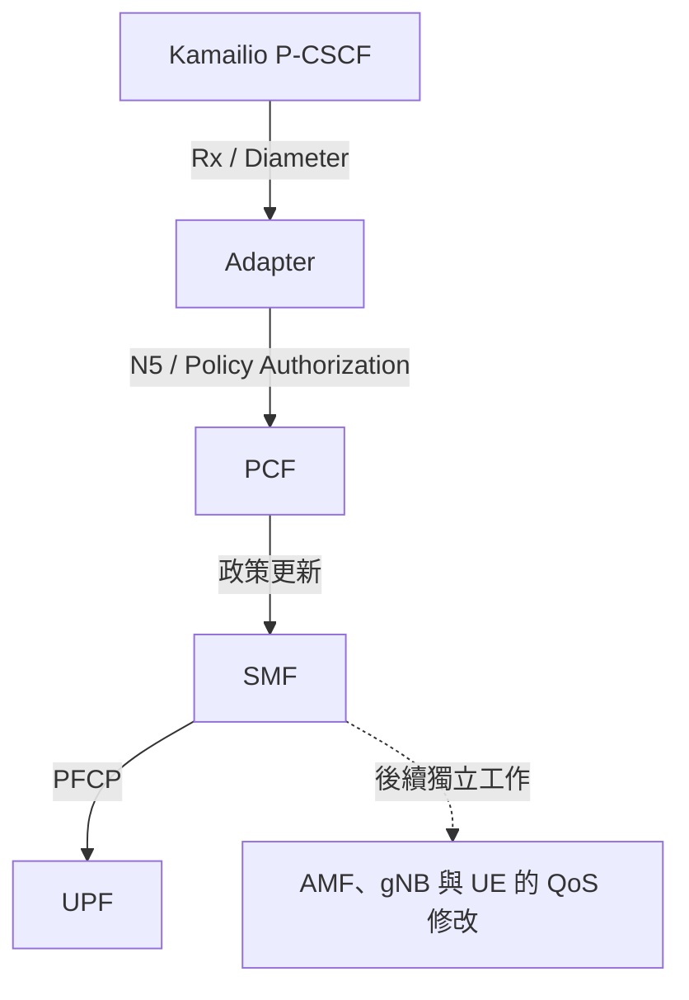

# Kamailio × free5GC：Rx／N5 Adapter 第一階段規格

版本：v0.1｜日期：2026-10-22｜狀態：供討論的設計初稿，尚非已驗證實作規格

## 0. 文件定位與閱讀方式

本文件定義保留 Kamailio IMS、以 Rx／N5 Adapter 取代現有 AF shim 的第一階段工作。目標讀者為專案開發者、指導者與測試者，可直接放入 HackMD 或 repository 討論。

- **提案要求**：本文件提出、待團隊接受的實作行為，以「應／不得」表示；不是宣稱全部來自 3GPP。
- **已閱讀資訊**：來自專案文件、腳本、論文與 Ella 文件；沒有等同完成獨立實測。
- **TBD**：必須透過選定版本的規範、原始碼或抓包確認，不得以猜測補齊。
- 本版未完成 3GPP 正式版本與章節逐項核對，也未執行端到端環境。TBD 項目有明確完成門檻，不能把 v0.1 當作已認證的相容性規格。

## 1. 問題與目標

既有專案文件描述：Kamailio P-CSCF 透過自訂 HTTP 將媒體需求交給 AF shim，再由 shim 呼叫 free5GC PCF。此方式能作為基本通話 PoC，但不足以證明標準 Rx 對接、完整資源清理與 UE／RAN QoS 程序。

本階段新增 Adapter，接收 Kamailio 的 Rx 請求並轉換成 Npcf_PolicyAuthorization 操作。Adapter 負責轉換、資源關聯與錯誤處理；政策決策由 PCF 負責，SIP 由 Kamailio 負責，媒體封包不經 Adapter。

成功目標：在受控實驗環境中，完成 AUDIO 通話資源建立與釋放；同一請求重送不造成重複建立；失敗資源可追蹤；可用訊息與資源證據驗收。

## 2. 範圍與分期

| 第一階段納入 | 說明 |
|---|---|
| Diameter peer 基礎功能 | 連線、能力交換、watchdog、斷線事件；實際 transport 與 AVP 依部署版本確認 |
| AAR／AAA | 新通話的 AUDIO 媒體授權請求；正確區分重送、既有 session 與更新 |
| STR／STA | 終止關聯 App Session，追蹤刪除結果 |
| N5 client | 建立與刪除 App Session，解析正式 API response 與資源 URI |
| 狀態與並行管理 | 每個 session 序列化、持久化資源關聯、去重與失敗紀錄 |
| Kamailio 整合 | 使用 ims_qos／cdp；避免同一通話同時走 shim 與 Adapter |
| 測試與觀測 | 單元、整合、通話基準、資源清理與失敗案例 |

| 後續階段／獨立工作 | 第一階段限制 |
|---|---|
| re-INVITE／媒體 PATCH | 不承諾更新能力；不得把修改過的 AAR 當成重送成功 |
| 信令 session 與事件訂閱 | 不主動開啟未支援的訂閱；收到要求時依規範明確處理 |
| PCF terminate → ASR、事件 → RAR | 完整雙向行為留待下一階段；第一階段保留 callback 接口及異常記錄，不假裝已完成處理 |
| BSF／動態 PCF 選擇 | 第一階段採單一設定 PCF，限於已知 session 綁定環境 |
| SMF N1／N2 QoS 修改 | 獨立驗證與實作，不計入本階段 Adapter 完成度 |
| HSS 併入 UDM／UDR | 獨立規格；不在本次修改範圍 |
| 視訊、IPv6、EPS fallback、HA | 後續評估；本階段採 IPv4 AUDIO 實驗 profile |
| 真實手機、商用部署及 QoE 保證 | 不屬於本階段成果宣稱 |

## 3. 環境與版本基準

實作前需建立 baseline manifest，不得只記錄 main／master。

| 項目 | 必填資料 | 目前狀態 |
|---|---|---|
| 計畫 repo 與實驗 submodule | URL、commit、submodule commit | 待選定 |
| free5GC／PCF／SMF／AMF／UPF | release、各 NF commit、gtp5g 版本 | 舊文件的部署與查證版本不同，待統一 |
| Kamailio | 版本、映像 digest、ims_qos／cdp 設定 | 待選定 |
| free-ran-ue／SIPp | 版本、patch、情境檔 commit | 待選定 |
| OpenAPI client | module 版本、API schema 來源 | 待選定 |
| Go／OS／Docker | 版本、kernel、compose 設定 | 待實測記錄 |
| 3GPP | 每份 TS 的完整版本與章節 | 見 §14；尚未查核完成 |

實驗前置條件：兩個 UE 已完成資料連線；訂閱允許 ims DNN；UE 能取得且到達 P-CSCF；IMS 認證資料一致；既有 IMS 註冊可成功；N3／N6 路由與 UE-to-UE 媒體可達；本專案 ims 路徑保留 UE 位址；預設信令 QoS 有明確設定。

IMS voice support 宣告應與實際部署能力及測試目標一致，不以單獨改 imsVoPS 為完整驗收。MSISDN 是否必要依本專案身分模型決定，不直接沿用 Ella 的產品限制。

## 4. 架構與責任

- P-CSCF：根據 SIP／SDP 提出媒體需求，處理 Rx 回覆與通話狀態。
- Adapter：檢查輸入、轉換資料、管理 Rx／N5 資源關聯、處理重送及清理。
- PCF：處理政策授權並與 SMF 互動。
- SMF／UPF：配置對應網路與封包規則。
- Adapter 不解析所有 SIP 流程、不自行選擇政策優先權，不處理 RTP 音訊。

## 5. Session 模型與必要不變量

**提案：一個 Rx session 對應一個 PCF App Session。** 註冊信令與通話資源不依 UE 身分任意合併；一通兩端 UE 的電話可能涉及多個 Rx session，不能假定 SIP Call-ID、UE、Rx session 與 App Session 全部一對一。

| 資料 | 用途 |
|---|---|
| rxSessionId | Rx session 主識別 |
| peerHost／peerRealm | 驗證來源、後續訊息路由 |
| callbackKey | 不直接暴露使用者身分的隨機識別；不是驗證憑證 |
| resourceUri／appSessionId | 保存 PCF 原始資源關聯 |
| pcfServiceBaseUri | 保存此 session 實際使用的 PCF 服務根位址 |
| UE identity／IPv4／DNN | 綁定需求與排錯；敏感資訊遮蔽 |
| request fingerprint／transaction metadata | 區分相同交易重送與新操作 |
| media components | 保留 component／flow number，不覆蓋其他元件 |
| state／generation／pendingTermination | 處理並行、晚到回覆與終止意圖 |
| last outcome／retry count／timestamps | 重試、稽核與人工清理 |

必要不變量：

1. 同一有效 Rx session 不因重送新增第二個 App Session。
2. 不以 UE 身分作為唯一通話資源鍵；清理一個 session 不得影響另一個。
3. 建立成功且資源關聯可保存後，才可宣告本次政策授權成功；此成功不表示 gNB／UE 已完成 QoS。
4. 未確認遠端刪除前，不得丟棄唯一的 URI／狀態資訊。
5. 不把 timeout 當成「遠端一定沒有執行」。
6. 不支援的功能不得回覆成已完成。

## 6. Rx 與 N5 契約

### 6.1 輸入與欄位對應

以下為第一階段 mapping 草案，正式必要性、型別、enum 與 Diameter 錯誤 AVP 應以鎖定版本規範及 OpenAPI 確認。

| Rx 資訊 | N5／本地用途 | 本專案提案 |
|---|---|---|
| Session-Id | session store | 不得為空；新舊 session 分流 |
| Origin-Host／Realm | peer 綁定 | 與已允許 peer 檢查 |
| Framed-IP-Address | ueIpv4 | 本階段要求有效 IPv4 |
| Subscription-Id | SUPI／身分綁定 | 使用明確 provisioned mapping；不得任意把電話號碼轉成 IMSI |
| Called-Station-Id | dnn | 使用時驗證允許值；缺少時可用明確設定的 ims 預設值 |
| AF-Application-Identifier | afAppId | 缺少時使用已記錄的設定預設值 |
| Media-Component-Number | medComponents key／medCompN | 保留編號，拒絕不合法重複 |
| Media-Type | medType | 本階段支援 AUDIO；其他依明確錯誤路徑處理 |
| Media-Sub-Component／Flow-Number | medSubComps | 保留各 flow 邊界 |
| Flow-Description | fDescs | 依規範視角與 PCF 行為確認上下行；不得未驗證就直接換位址 |
| UL／DL bandwidth | marBwUl／marBwDl | 以 bps 為輸入基準，依 schema 轉換，檢查範圍與溢位 |
| Flow-Status／Codec-Data／Flow-Usage | 對應媒體欄位 | 依版本確認合法值及缺省規則 |
| Specific-Action | 事件需求 | 不默默承諾第一階段未實作的事件 |

IMPU user part 推導 IMSI 只可在開戶規則明確保證且設定啟用時使用，並驗證 realm 與訂閱資料。無法安全綁定時，第一階段提案採拒絕，避免自動退回未驗證的 IP-only 搜尋。

未知 AVP 應依 Diameter 的 M-bit、應用規範與字典能力處理，不能一概忽略或一概拒絕。

### 6.2 N5 API 與 URL

| 操作 | 預期形式 | 定稿要求 |
|---|---|---|
| Create | POST app-sessions collection | 依鎖定 schema 確認 request、201 回應、Location 與必要欄位 |
| Release | PolicyAuthorization Delete 操作 | 既有設計採 POST {resourceUri}/delete；不得因名稱為 Delete 就改用 HTTP DELETE |
| Update | PATCH individual resource | 本階段不啟用；不可默默轉成重建 |
| Callback | 由 Adapter 提供可達 URI | free5GC 既有文件描述 terminate 使用 notifUri 加 /terminate；須對照目標版本 |

- 使用與部署版本匹配的 OpenAPI client／model。
- 區分 NF endpoint、service apiPrefix 與 individual resource URI；不得假設 API 永遠位於主機根路徑。
- 使用 URL parser／resolver，處理 scheme、FQDN、IP、port、prefix 與合法相對 Location；保留完整資源 URI。
- Location／callback 位址須通過允許來源檢查，不可接受任意主機導向；錯誤 Location 不得只用字串最後一段猜 ID。
- HTTP/2 h2c／TLS、OAuth／mTLS 依 profile 明確設定。實驗性關閉安全機制須記錄，不能當成標準要求。
- 成功 status、ProblemDetails cause 與 Diameter Result-Code／Experimental-Result 對應是實作前必須完成的表格；本版不填未核實的數值。

## 7. 正常與異常流程

### 7.1 新通話 AAR

1. 驗證 peer、訊息結構、支援 profile 及必要欄位。
2. 對 rxSessionId 原子取得處理權，辨識是否為重送、更新或新 session。
3. 保存 CREATING 狀態及操作識別，再向 PCF 發出 Create。
4. 成功後驗證回應與 Location，持久化資源 URI，轉為 ACTIVE，再回覆 AAA。
5. 若終止請求已先到達，轉入釋放流程，不讓晚到的成功留下孤兒資源。
6. 明確失敗：記錄終止狀態與可用的重送回覆。timeout／不完整成功回覆：進入 CREATE_UNKNOWN，不盲目重試 Create。
7. 若 PCF 成功但本地保存失敗，嘗試補償刪除；若仍無法完成，留下可恢復的事件／清理紀錄，不宣告正常成功。

### 7.2 相同 session 的後續 AAR

- 同一 Diameter 交易的重送：依協定交易識別與 fingerprint 判定，合併進行中的操作或重送已保存的答案，不再 Create。
- 同一 Session-Id 不表示一定是重送；若是合法的新授權／更新操作，必須走獨立判斷。
- 已 ACTIVE 且媒體需求變更：第一階段不支援 PATCH，回覆已定義的拒絕結果，保持原有資源，不默默回成功。
- CREATE_UNKNOWN：停止自動重建，回覆明確失敗／暫時不可用結果並告警；正式 code 在規範核對後定稿。

### 7.3 STR 與釋放

1. 驗證 peer 與 Session-Id，序列化處理。
2. ACTIVE → DELETING，保存終止意圖後向 PCF 釋放資源。
3. 確認成功刪除後轉為 CLOSED，保留短期 tombstone／重送回覆資訊。
4. 如果 PCF 表示資源不存在，只有在確認該狀態確實代表原資源已消失時才完成清理，不把所有 404 一概當成功。
5. 刪除 timeout 或可重試失敗：轉為 DELETE_PENDING，保留 URI 並執行有界重試；不回覆「所有遠端資源已清除」的假成功。
6. 找不到 session：區分已完成的 tombstone 與真正未知 session；答案依 Rx 規範定稿，不預設一律成功。
7. CREATING 時收到 STR：設定 pendingTermination；如果 Create 隨後成功，立即安排刪除。

### 7.4 Callback 與第一階段限制

Create 使用的 callback URI 必須對 PCF 可達且有 handler，不得留下已知 404 路徑。

本階段 handler 應驗證來源、記錄已識別的通知與 session 關聯，並按鎖定 API 契約回應。不得因接收通知就記錄成「已對 Kamailio 完成 ASR／RAR」。完整的通知轉送不屬於第一階段驗收；被要求的必要事件無法支援時應拒絕相關 profile。若規範或部署要求完整終止處理為基本前提，必須擴大範圍完成後才能宣稱該 profile 相容。

## 8. 狀態、並行與恢復

| 狀態 | 意義 | 可採取動作 |
|---|---|---|
| CREATING | Create 進行中 | 合併重送、記錄終止意圖 |
| ACTIVE | 資源已知且有效 | 正常終止；不支援的更新明確拒絕 |
| CREATE_UNKNOWN | 可能已建立但結果不明 | 凍結重建、調查遠端狀態與人工清理 |
| DELETING | Delete 進行中 | 合併重送 |
| DELETE_PENDING | 刪除未確認 | 有界重試、告警與人工介入 |
| CLOSED | 已確認終止 | 保留短期去重資訊，不再操作其他資源 |

提案採持久化 session store 或操作 journal，介面須可替換；具體儲存技術待團隊決定。若暫採記憶體版本，只能標為開發 PoC，不能通過重啟恢復驗收。

每個 session 由單一 worker 或等價鎖定機制序列化；共享索引、peer 表與跨 session 資料仍必須同步，不能因單一 worker 就宣稱整個程式不需鎖。網路等待不得持有全域鎖。晚到回覆以 operation ID／generation 驗證，避免覆蓋新狀態。

重啟後，將未完成的 Create 視為結果待確認，將有已知 URI 的刪除恢復為待清理。不得假定 PCF 提供依自訂 token 查詢或列出全部 App Session 的能力；無法協定內調和的 CREATE_UNKNOWN，須以實驗管理流程確認、人工清理並保留紀錄。

## 9. 設定與操作要求

以下數值為實驗初始提案，需與 Kamailio timeout 核對後調整，不是 3GPP 規定。

| 設定 | 初始提案 |
|---|---|
| Diameter | 明確 bind address、port、Origin-Host／Realm、允許 peer |
| PCF | 完整 service base URI、HTTP transport、安全 profile |
| Callback | 實際可達 advertised base URI，不使用 0.0.0.0 |
| 身分綁定 | provisioned mapping；IMPU 推導預設停用 |
| DNN／媒體 | ims；IPv4 AUDIO |
| PCF request timeout | 3 秒，可配置；需短於外層等待預算並預留回覆時間 |
| Delete retry | 首次失敗後最多 5 次，基礎間隔 1/2/4/8/16 秒加 jitter；只重試可重試錯誤 |
| Create retry | 結果未知時不自動重送 |
| Tombstone | 暫定 10 分鐘，須涵蓋實際重送窗口 |
| Pending cleanup | 超過 60 秒告警；不因 TTL 自動刪除清理資訊 |

優雅關閉停止接收新建立請求，保存進行中狀態，對無法完成的操作提供可恢復紀錄。日誌不得包含 K／OP／OPc、認證向量或 access token；SUPI／IMPU 以遮蔽或內部關聯識別顯示。

## 10. 可觀測性

每個操作記錄 correlation ID、session 內部 ID、方向、operation、前後狀態、PCF status／cause、耗時與 retry count。不得僅記「成功」而無法對應請求。

指標至少包括：Rx／N5 操作成功失敗與 timeout 次數、各狀態 session 數、CREATE_UNKNOWN 與 DELETE_PENDING 數、清理重試／耗盡次數、peer 連線狀態。健康檢查應區分程序存活與是否可處理新請求。

## 11. 測試與驗收

### 11.1 測試矩陣

| ID | 情境 | 必須觀察的結果 |
|---|---|---|
| T01 | 合法 AUDIO AAR | 一個對應 App Session；保存 URI；正確 AAA |
| T02 | 必要欄位缺失／IP 錯誤 | 明確拒絕；PCF Create 呼叫為零 |
| T03 | 不支援媒體／必要事件 | 不假成功，不建立不支援資源 |
| T04 | Create 進行中及完成後重送 | 同一交易不造成第二次 Create |
| T05 | ACTIVE 上的變更 AAR | 與重送區分；不支援時保持原資源並拒絕 |
| T06 | 正常 STR | App Session 與其專用規則消失；其他資源不受影響 |
| T07 | 重複 STR／未知 session | 依 tombstone／未知分流，不誤刪 |
| T08 | PCF 明確拒絕 | 正確錯誤映射，不回成功 |
| T09 | PCF 已執行 Create 但回覆遺失 | CREATE_UNKNOWN；不盲目再建；可追蹤調查 |
| T10 | PCF 成功後本地保存失敗 | 補償或可恢復清理紀錄；不留下不可追蹤資源 |
| T11 | Delete timeout／失敗 | 保存 URI、有界重試、耗盡告警 |
| T12 | AAR／STR 並行、晚到 Create | 終止意圖不遺失；晚到資源安排清理 |
| T13 | 同 UE 多個 Rx session | 各自獨立；刪一個不影響另一個 |
| T14 | Adapter 重啟 | 已知關聯與待清理工作可恢復 |
| T15 | URL 與綁定測試 | 非根 apiPrefix、FQDN／IP、Location 形式正確；拒絕非允許目標 |
| T16 | Flow 上下行 | 對照 Rx、N5、N7／PFCP 與實際 UE 位址／port，方向正確 |
| T17 | callback | 路徑可達、來源驗證、未知 session／重複通知可追蹤；不虛報 ASR 完成 |
| T18 | 端到端兩 UE 通話 | IMS 註冊、INVITE／回覆／ACK／BYE 與雙向 RTP 證據可對應 |

資料對應用 table-driven tests；狀態機用可注入延遲／故障的 PCF stub；整合測試使用實際 PCF。並行狀態與共享 store 應執行 race detector。封包資料可作測試 fixture，但須移除真實身分與敏感資料。

### 11.2 分層判定

| 層級 | PASS 的必要證據 | 本階段 |
|---|---|---|
| L1 基本通話 | SIP 流程及可解析雙向 RTP，對應 N3 GTP-U 內層 flow | 必須 |
| L2 政策生命週期 | Rx／N5 建立、釋放與 session 關聯一致 | 必須 |
| L3 UPF 規則 | 通話前／中／後專用規則差異，含對應 QER 資訊 | 必須 |
| L4 UE／RAN QoS | N1／N2 修改及成功回應、QFI／flow 關聯 | 獨立工作，未驗證須標示 |
| L5 傳輸品質 | 明確負載、瓶頸與路徑下的延遲／丟包／頻寬等結果 | 後續工作 |

沿用 03-call-test.sh 作為起點，新增 Rx/N5 與資源前後對照；以 tshark 等解析 SIP／RTP／Diameter，不以字串或最大相同封包長度群代替正式判定。缺少必要工具時輸出 SKIP／BLOCKED，不能將 L3 未驗證算入本階段整體 PASS。

需保存：版本 manifest、測試命令與退出碼、帶時間的 log、pcap、PCF 資源證據、UPF 規則快照、逐案結果。若無管理 API 可直接查詢 PCF 資源，應使用可重現的測試探針或授權的測試環境查核，不假設不存在的列舉 API。

## 12. 與原草案的差異

| 原文件設計／待釐清點 | 本版提案 |
|---|---|
| Delete 失敗僅記 log 後丟棄 session | 保留 URI、DELETE_PENDING、有界重試與告警 |
| 不存在的 STR 一律成功 | 區分已關閉 tombstone 與真正未知 session，依規範定稿 |
| 不明 SUPI 回退 IP-only 綁定 | 第一階段要求安全可驗證的綁定，無法確認時拒絕 |
| 未知 AVP 一律忽略 | 依 M-bit 與應用規範處理 |
| 每 session worker 就不需鎖 | 仍同步共享索引，處理晚到回覆與並行終止 |
| Flow-Description 原樣複製／必要時交換 | 在實作前以規範與封包確定方向，不憑測試通話成功推斷 |
| 單一通話 PASS | 分層驗收，SKIP 不冒充 QoS 通過 |
| 記憶體 session store | 正式階段要求可恢復資源關聯；記憶體版限開發 PoC |

以上是供評審採納的修改建議，尚未修改原 repository。

## 13. 工作順序與完成門檻

1. **G0 基準**：固定版本，跑原始腳本，保存現況證據；未成功先排查環境。
2. **G1 設計核對**：關閉下表阻擋項，確認 Rx 字典、API、身分與 flow 語意。此門檻前可做原型，不可宣稱相容完成。
3. **G2 元件實作**：peer、mapper、PCF client、持久化狀態機、fault tests。
4. **G3 整合**：Kamailio 切到 Rx，在隔離實驗環境驗證 L1–L3；避免 shim 與 Adapter 雙重預留。
5. **G4 交付**：README、設定範例、測試結果、已知限制與清理 runbook，並記錄回復舊 shim 的程序。

| TBD | 問題 | 完成依據／門檻 |
|---|---|---|
| D01 | 部署與 OpenAPI 版本 | G0：manifest 與依賴鎖定 |
| D02 | Rx/N5 欄位、錯誤碼、STA 時機與去重 | G1：確切規範版本／章節與測試預期 |
| D03 | Kamailio 實際 AAR／STR、必要 AVP／事件 | G1：目標版本設定與封包樣本；必要能力不支援則調整範圍 |
| D04 | N5 URL、Location、callback、安全 profile | G1：client／server 程式與 contract test |
| D05 | 身分綁定與 flow 方向 | G1：開戶資料及跨介面封包對照 |
| D06 | 持久化、重送窗口、timeout | G1：團隊決策；G2：故障與重啟測試 |
| D07 | Ella 可借鏡或重用的程式 | 實際檔案／commit／測試與授權；不能只憑 README 判定 |
| D08 | PCF 未知建立結果如何清理 | G1：可操作 runbook；無法自動調和的限制明確記錄 |

完成定義：G0–G4 證據齊全，必須測試沒有未說明的 FAIL／SKIP，資源釋放與隔離可重現。若 L4／L5 尚未完成，只能稱為「第一階段 Rx／N5 整合完成」，不得稱完整 VoNR QoS 已驗證。

## 14. 參考資料與規範核對清單

### 14.1 已閱讀來源

- [專案 README](https://github.com/djhih/kamailio-free5gc)：目標與現況定位。
- [總計畫](https://github.com/djhih/kamailio-free5gc/blob/master/docs/plan/vonr-ims-nf-plan.md)：W1–W8 分期，來自先前閱讀，不代表今日已重新實測。
- [Adapter 設計](https://github.com/djhih/kamailio-free5gc/blob/master/docs/plan/rx-n5-adapter-design.md)：本次重新讀取；檔案 blob SHA `e353eb6ad50b5d0d08712a83190b8ecd0e894532`。此為檔案 SHA，非 repository commit。
- [實驗腳本](https://github.com/DBGR18/kamailio-free5gc/blob/main/scripts/03-call-test.sh)：先前讀取的 blob SHA `00b6a7b80e98c015dd9e8d7f7dd9883f3499d6d2`，需與實際 submodule 版本比對。
- 2024 年實驗室碩論：已讀上傳原文第 3.1 節及相關實驗段落；流程參考，不代表其程式已取得或結果已重現。
- [Ella IMS](https://github.com/ellanetworks/ims)：已讀 README，宣告 Rx／N5 能力；尚未完整審查政策實作。
- [Ella Core Voice Integration](https://github.com/ellanetworks/core/blob/main/docs/explanation/voice_integration.md)：前置條件、Cx／Rx、資源生命週期。
- [Ella Core 支援能力](https://github.com/ellanetworks/core/blob/main/docs/reference/3gpp_compliance.md)：單一程式的架構限制與功能範圍。

### 14.2 待查核的標準，不作已驗證引用

| 文件 | 查核內容 | 完整版本／章節 |
|---|---|---|
| 3GPP TS 29.214 | Rx AAR／STR、AVP、錯誤、終止與事件行為 | TBD |
| 3GPP TS 29.514 | Policy Authorization schema、API、callback、錯誤與資源 URI | TBD |
| 3GPP TS 29.513 | Rx／5GS 互通與 session 對應；既有計畫指向附錄 B | TBD |
| 3GPP TS 29.500／29.501 | SBI、apiRoot／apiPrefix、HTTP 與 API 命名規則 | TBD |
| 3GPP TS 23.503 | 政策與 QoS 需求責任 | TBD |
| 3GPP TS 23.502／23.501 | 後續 QoS 修改程序與 5QI 特性 | TBD |
| IETF RFC 6733 | Diameter base、peer、M-bit、交易識別與重送 | 待核對相關章節及 Rx 引用規範 |

原計畫使用 Rel-17 作為研究方向；本版暫沿用方向，但必須選定各 TS 的完整版本，核對目標軟體差異後才能標示符合。不得以其他開源實作或本文件提案取代標準條文。
