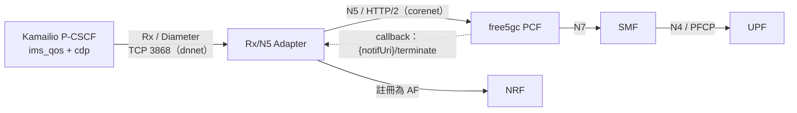
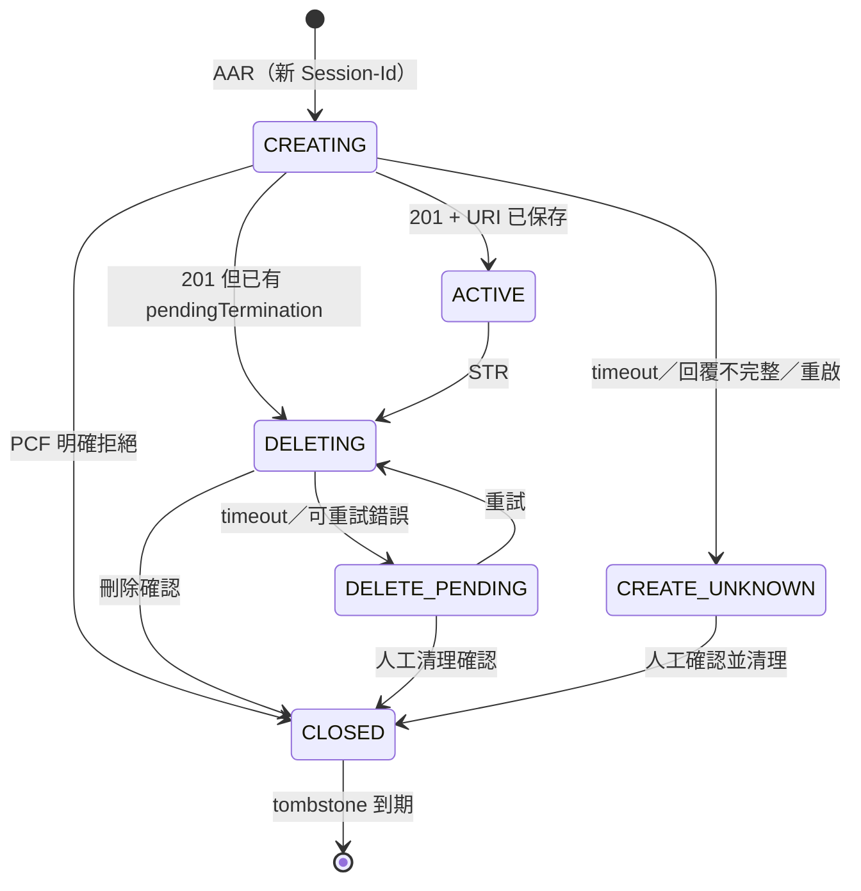
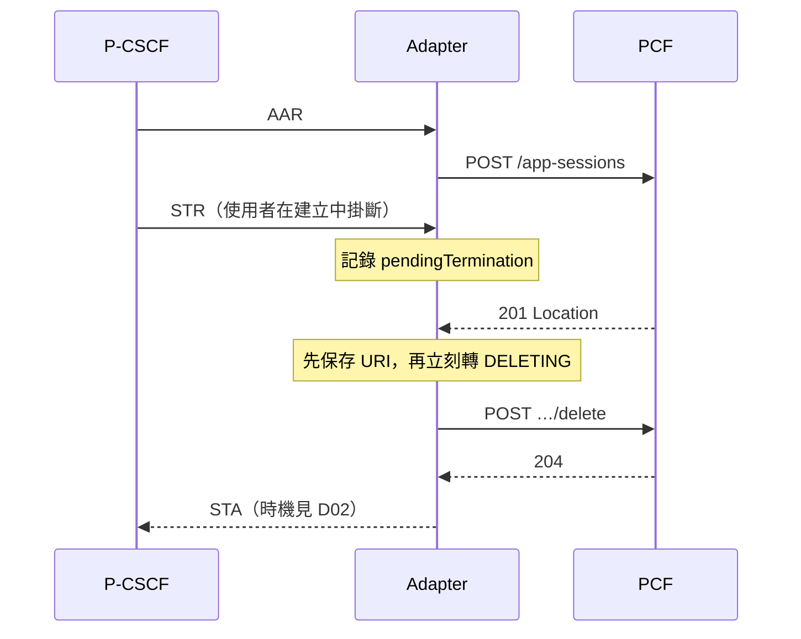
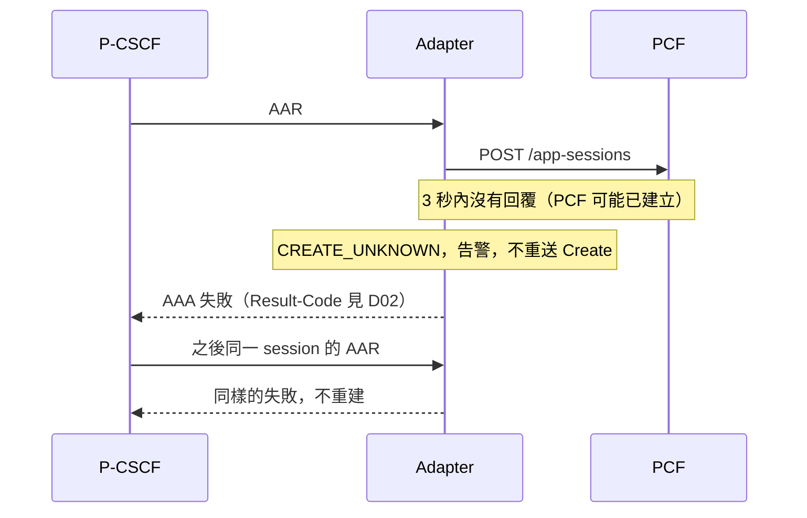
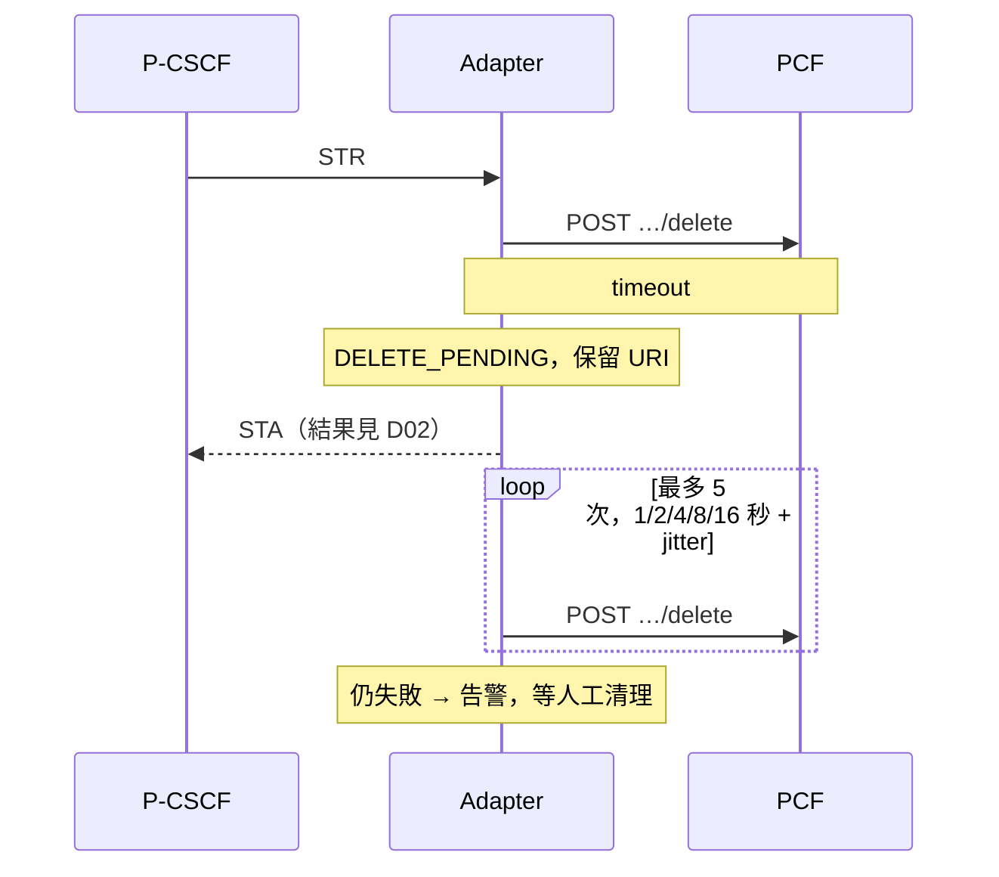
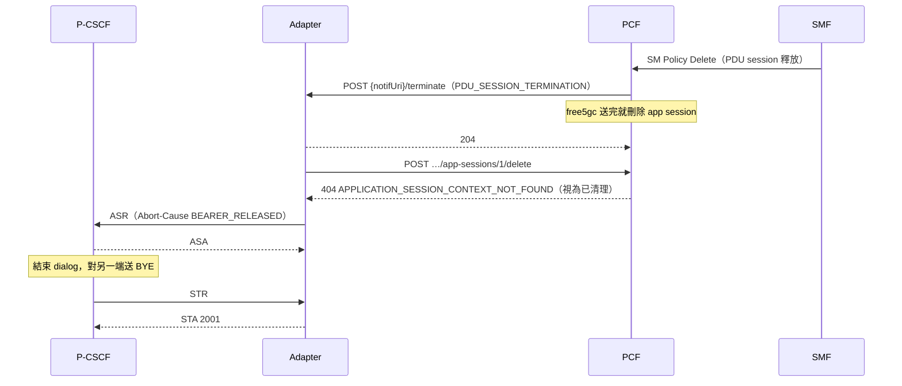
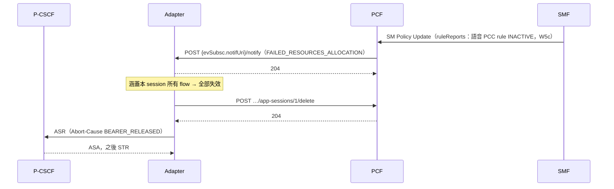
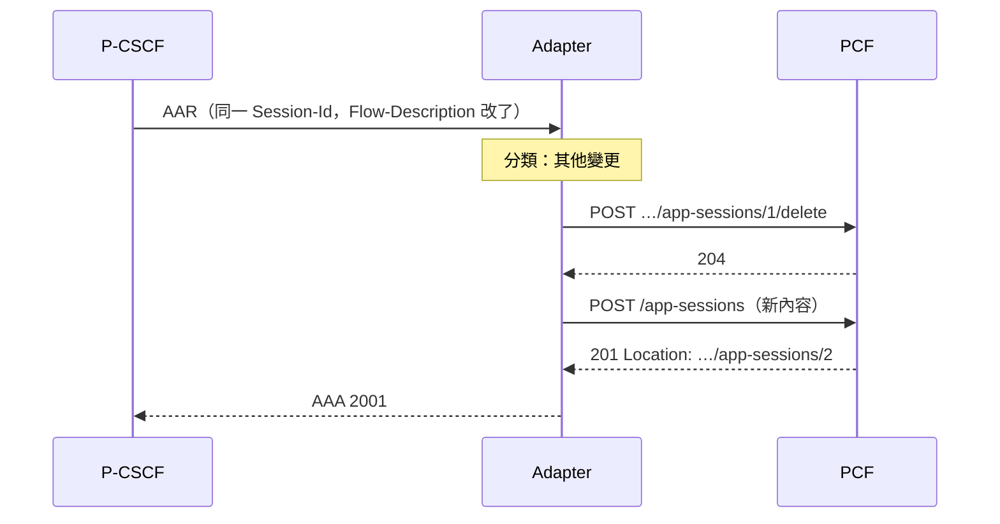

# Rx／N5 Adapter 設計文件

| 項目 | 內容 |
|---|---|
| 版本／狀態 | v0.6／設計審查中（尚未實作；v0.4 加入 W3b，v0.5 加入 W3d，v0.6 加入 W3c 與 W5d 的 Adapter 端） |
| 作者 | 見 git log |
| 審查者 | TBD |
| 範圍 | W3a（通話資源）＋W3b（5GC 回報）＋W3c（IMS 註冊時、BSF）＋W3d（通話中修改）＋W5d 的 Adapter 端；後續見 §13 |
| 相關文件 | [explained.md](explained.md)（範例）、[interface-spec.md](interface-spec.md)（需求）、[test-plan.md](test-plan.md)、[adr/](adr/) |

## 1. 摘要

新寫一個 Adapter，接收 Kamailio P-CSCF（`ims_qos`＋`cdp`）送出的標準 Rx（Diameter）請求，轉成 free5gc PCF 的 N5（Npcf_PolicyAuthorization），取代現在用自訂 HTTP 的 AF shim。Adapter 只做轉換、Rx session 與 PCF app session 的關聯、重送與清理；policy 由 PCF 決定，SIP 由 Kamailio 處理，RTP 不經過 Adapter。第一階段只做 IPv4 AUDIO 通話的建立與釋放，並把「結果不明」與「刪除未確認」當成一級狀態處理，而不是只記 log。W3b 補上反方向：PDU session 結束或語音資源失效時，PCF 的通知被轉成 ASR（或部分失效時的 RAR），讓 Kamailio 結束通話（TS 23.228 附錄 Y.2.4、TS 29.214 §4.4.6）。

## 2. 背景與動機

現在 Kamailio 在設定檔裡手寫路由，把 SDP 用 base64 塞進自訂 JSON 送給 AF shim，shim 再呼叫 PCF。這能跑通基本通話，但有三個缺口（細節見 [explained.md](explained.md) §2 與 [../overview/free5gc-kamailio-integration.md](../overview/free5gc-kamailio-integration.md)）：

| 缺口 | 後果 |
|---|---|
| 不是標準 Rx，Kamailio 沒用 `ims_qos` | 證明不了 IMS 能以標準介面接上 5GC；換任何一邊都要重寫 |
| 只有 IMS → 5GC 單向；`/notify/terminate` 回 404 | PDU session 沒了，通話還掛著 |
| 同步呼叫、失敗只記 log | PCF 慢時卡住 Kamailio；刪除失敗會留下沒人知道的 PCC rule |

## 3. 目標與非目標

**目標（W3a）**

1. Kamailio 以 `ims_qos` 送出的 AAR／STR，能在 PCF 建立與釋放對應的 app session，UPF 上的語音規則隨之出現與消失。
2. 重送不會造成重複建立；一通電話的兩段（主叫、被叫）互不影響。
3. 任何失敗都留下可追蹤、可清理的紀錄，不回報假成功。
4. 能用抓包與資源快照驗收（[test-plan.md](test-plan.md) L1–L3）。

**目標（W3b）**

5. PDU session 被釋放時，PCF 的 terminate 讓 Kamailio 收到 ASR 並結束通話，兩支 UE 都收到 BYE（L2b）。
6. 語音資源全部失效（例如 RAN 拒絕語音 QFI，經 SMF 回報）時，同樣以 ASR 結束通話；部分失效時送 RAR，不結束通話。

**目標（W3d）**

7. re-INVITE 只改頻寬或 codec 時以 PATCH 更新；改了 port、方向（hold／resume）或媒體元件時，以 Delete 再 Create 更新，不留下孤兒 PCC rule（[ADR-0009](adr/0009-patch-or-replace-on-aar-update.md)）。

**目標（W3c）**

8. Kamailio 呼叫 `Rx_AAR_Register` 時，Adapter 依 `w3c.mode` 處理，不會讓 IMS 註冊失敗，也不會傷到語音 QoS（[ADR-0010](adr/0010-w3c-modes.md)）。
9. 可以用 BSF 依 UE IP 找 PCF。

**非目標**（都是「合理可能被當成目標」但這次刻意不做的事）

| 非目標 | 為什麼這次不做 | 何時做 |
|---|---|---|
| 視訊或第二個媒體元件 | W3d 仍只接受 AUDIO（REQ-AAR-04）；加媒體元件會走 Delete＋Create，但 PCF 對 VIDEO 給 5QI 2，需要另外驗證 | 未排定 |
| ANI、計費關聯（CHARGING_CORRELATION_EXCHANGE）、USAGE_REPORT 轉成 RAR | 通話與註冊都用不到 | 未排定 |
| gNB／UE 收到 QoS flow 修改 | 屬於 SMF（W5），不是 Adapter 的責任 | W5 |
| 視訊、IPv6、EPS fallback、HA | 實驗環境用不到，會讓狀態機複雜一倍 | 未排定 |
| 真實手機、QoE 保證 | 不在研究範圍 | — |

## 4. 一個例子

完整的一通電話（兩支 UE、兩段 Rx session、AAR 內容、翻好的 N5 JSON、正常掛斷與異常斷線）見 [explained.md](explained.md) §4。下面的設計都以那通電話為例。

## 5. 設計

### 5.1 架構與責任



| 元件 | 負責 | 不負責 |
|---|---|---|
| P-CSCF | 依 SIP／SDP 產生 AAR／STR；依 AAA 結果決定通話是否繼續 | policy |
| Adapter | 檢查輸入、Rx ↔ N5 轉換、session 關聯、重送判定、清理 | SIP、SDP、QoS 決策、RTP |
| PCF | policy 授權、通知 SMF | Rx |
| SMF／UPF | 安裝與移除封包規則 | — |

### 5.2 Session 模型

一個 Rx session 對應一個 PCF app session（[ADR-0002](adr/0002-one-app-session-per-rx-session.md)）。一通電話通常有兩個 Rx session（主叫、被叫各一個 PDU session），所以 Call-ID、UE、Rx session、app session 不能假設一對一。

每筆 session 記錄的欄位與用途見 [interface-spec.md](interface-spec.md) §9.1。必須維持的不變量：

1. 同一個有效 Rx session 不因重送而多出第二個 app session。
2. 不以 UE 身分當唯一 key；清理一個 session 不影響另一個。
3. app session 建立成功**且**資源 URI 已保存，才回 AAA 成功。這只代表 PCF 授權成功，不代表 gNB／UE 已有 QoS flow。
4. 遠端刪除未確認前，不丟棄唯一的資源 URI。
5. timeout 不等於「遠端沒有執行」。
6. 不支援的功能不回報成功。

### 5.3 狀態機



完整的「狀態 × 事件 → 動作 → 下一狀態」轉移表是規格的一部分，見 [interface-spec.md](interface-spec.md) §9.2。兩個異常狀態的理由：

- `CREATE_UNKNOWN`：Create 逾時時 PCF 可能已經建好了。自動重送會建出第二個 app session，而 PCF 沒有提供依自訂 key 查詢 app session 的 API，所以凍結並交人工確認（[ADR-0004](adr/0004-no-blind-create-retry.md)）。
- `DELETE_PENDING`：舊設計刪除失敗只記 log 就丟掉 session，PCF 與 UPF 上會留下沒人知道的規則（[ADR-0005](adr/0005-keep-resource-until-delete-confirmed.md)）。

### 5.4 時序

**正常建立與釋放（一段 Rx session）**

```mermaid
sequenceDiagram
    participant K as P-CSCF
    participant A as Adapter
    participant S as Session store
    participant P as PCF
    K->>A: AAR (Session-Id=…;1001;1)
    A->>S: 寫入 CREATING + operationId
    A->>P: POST /app-sessions
    P-->>A: 201 Location: …/app-sessions/1
    A->>S: 寫入 resourceUri，ACTIVE
    A-->>K: AAA 2001
    Note over K,P: 通話中
    K->>A: STR
    A->>S: DELETING
    A->>P: POST …/app-sessions/1/delete
    P-->>A: 204
    A->>S: CLOSED（保留 tombstone）
    A-->>K: STA 2001
```

**Create 還沒回來就收到 STR**



**Create 逾時**



**刪除逾時**



**W3b：PDU session 被釋放 → ASR**



**W3b：RAN 拒絕語音 QFI（全部失效）→ ASR**



**W3d：re-INVITE 改了 port（其他變更）→ Delete 再 Create**



### 5.5 程式結構

照 free5gc NF 骨架（[../overview/vonr-ims-dev-process.md](../overview/vonr-ims-dev-process.md) 第 1.2 節）。Diameter 部分參考 free5gc CHF：用 `github.com/fiorix/go-diameter`，字典 XML 寫成 Go 字串、以 `dict.Default.Load()` 載入，用帶 `avp:"..."` tag 的 struct 解碼（見 `NFs/chf/ccs_diameter/`）。

```
rx-n5-adapter/
├── cmd/main.go
├── pkg/
│   ├── app/app.go                  # App 介面
│   ├── factory/config.go           # 設定（interface-spec §11）
│   └── service/init.go             # context → store → consumer → processor → rx.Server → sbi.Server
└── internal/
    ├── context/context.go          # 設定值、NF instance ID、token
    ├── store/                      # SessionStore 介面；memory（PoC）與持久化實作（D06）
    ├── rx/
    │   ├── dict.go                 # Rx 字典（XML 字串）
    │   ├── types.go                # AAR、STR 等 struct（avp tag）
    │   ├── server.go               # Diameter server：CER/DWR、peer 白名單、依 command code 分派
    │   └── handler.go              # AAR／STR → processor
    ├── mapper/                     # 純函式：Rx ↔ N5，不碰網路
    │   ├── to_n5.go
    │   └── *_test.go               # 表格驅動測試
    ├── processor/                  # 狀態機（interface-spec §9）；每個 session 序列化
    ├── sbi/
    │   ├── server.go               # gin：/rx-n5/notify/{callbackKey}/terminate
    │   └── consumer/
    │       ├── nrf_service.go      # 註冊為 AF、取 token
    │       └── pcf_service.go      # PolAuth client
    ├── cleanup/                    # DELETE_PENDING 重試、CREATE_UNKNOWN 告警
    ├── metrics/
    └── logger/                     # 含遮蔽 SUPI／IMPU 的 helper
```

和 v0.1 的差異：把狀態機從 `sbi/processor` 移到獨立的 `processor/`（Rx 與 callback 共用）；新增 `store/`、`cleanup/`、`metrics/`；W3b 才需要的 `rx/sender.go`（RAR／ASR）與 W3c 的 `bsf_service.go` 先不建。

### 5.6 部署

Adapter 同時接兩個網段，和現在的 AF shim 一樣：

| 網段 | 用途 | 對象 |
|---|---|---|
| dnnet（10.100.100.0/24） | Rx：P-CSCF 連進來（TCP 3868） | P-CSCF |
| corenet（10.100.200.0/24） | SBI：呼叫 PCF、NRF；接收 PCF 回呼 | PCF、NRF |

HSS 的 Cx 也在 dnnet 用 3868（W8 前是 PyHSS，之後是 UDM），IP 不同所以不衝突。切換時 shim 與 Adapter 不得同時為同一通電話預留資源（REQ-OPS-02）。

## 6. 考慮過的替代方案

| 方案 | 做法 | 優點 | 缺點 | 結論 |
|---|---|---|---|---|
| **A. 保留並修補 AF shim** | 補 `/notify/terminate`、改成非同步 | 改動最小，現在就能跑 | 還是自訂協定；Kamailio 不用 `ims_qos`；證明不了標準對接，研究價值低 | 不採用 |
| **B. Kamailio 直接講 N5** | 在 Kamailio 設定檔用 HTTP client 模組組 N5 JSON | 少一個程序 | 本質上是把 shim 搬進 Kamailio 設定檔；SIP 路由與 policy 邏輯混在一起；重送、清理狀態很難在設定檔語言裡做對。就目前所知 Kamailio 沒有 N5 模組（待 D03 確認） | 不採用 |
| **C. 在 free5gc PCF 加 Rx** | PCF 自己當 Rx server | **最接近標準**：3GPP 預期由 PCF 支援 Rx（[explained.md](explained.md) §2 引 TS 23.503 附錄 C，章節待 D02 核對）；少一次轉換 | 違反計畫「不改 PCF」的原則；要長期維護 PCF fork；Diameter 狀態會和 PCF 原本的 SBI 狀態綁在一起 | 不採用，理由見 [ADR-0001](adr/0001-standalone-adapter.md)。保留成未來選項：Adapter 的 mapper 與狀態機可以搬進 PCF |
| **D. 改用 Ella IMS／Ella Core** | 用已宣告支援 Rx／N5 的 Ella 元件 | 現成 | Ella IMS 取代 Kamailio、Ella Core 取代 free5gc，兩者都違反專案前提 | 不採用；可借鏡的程式見 D07 |
| **E. 獨立 Adapter（本設計）** | 新程序，Rx server ＋ N5 client | 兩邊都不用改程式；可獨立測試與替換；之後要搬進 PCF 也容易 | 多一個程序與一份狀態；Rx 與 N5 的失敗語意要自己對齊 | **採用** |

### 6.1 W3b 的選擇

| 問題 | 選項 | 結論 |
|---|---|---|
| 收到 terminate 後，誰刪 app session | (a) 等 Kamailio 的 STR 再 Delete；(b) 回 204 後 Adapter 立刻 Delete，再送 ASR | (b)，[ADR-0007](adr/0007-delete-then-asr-on-terminate.md)：TS 29.514 §4.2.5.3 要求 N5 consumer 回 204 後呼叫 Delete；不依賴 Kamailio 一定會送 STR |
| 資源失效時送 RAR 還是 ASR | (a) 一律 RAR；(b) 全部失效送 ASR、部分失效送 RAR；(c) 一律 ASR | (b)，[ADR-0008](adr/0008-map-failed-resources-to-rar-or-asr.md)：TS 29.214 §4.4.6.2；free5gc PCF 在全部失效時只送事件、不送 terminate，由 Adapter 補上判斷 |
| RAR 的 Specific-Action 用 4 還是 9 | 依 AAR 訂閱了哪個 | 同上；TS 29.214 §5.3.13 Note 2a 允許兩者 |

## 7. 跨面向考量

### 7.1 安全（威脅模型）

| 威脅 | 入口 | 對策 | 需求 |
|---|---|---|---|
| 偽造 Diameter peer 建立／刪除別人的資源 | Rx 3868 | peer 白名單（Origin-Host／Realm＋來源 IP）；只綁 dnnet | REQ-PEER-03 |
| PCF 回的 `Location` 或設定被竄改，讓 Adapter 對任意主機發請求（SSRF） | N5 回應 | 只接受允許的 PCF base URI 下的 Location | REQ-N5-03 |
| 偽造 callback 讓 Adapter 改變 session 狀態 | callback 端點 | callbackKey 為隨機值；第一階段 callback 只記錄、不改資源；來源檢查 | REQ-CB-02、REQ-CB-03 |
| 用電話號碼冒用別人的 SUPI | Subscription-Id | 只用開戶 mapping；IMPU 推導預設關閉 | REQ-AAR-03 |
| 個資外洩到 log | log | 不記 K／OP／OPc／認證向量／token；SUPI／IMPU 遮蔽 | REQ-SEC-01 |
| 關閉 OAuth／TLS 被誤當成正式設定 | 設定 | 啟動時明確記錄「實驗 profile」 | REQ-SEC-02 |

實驗環境目前維持 NRF OAuth 關閉（計畫 §6 的既有風險），Rx 不加 TLS。這是實驗 profile，不是建議設定。

### 7.2 可觀測性

每個操作記錄 correlation ID、內部 session ID、方向、操作、前後狀態、PCF status／cause、耗時、retry 次數。指標與健康檢查見 [interface-spec.md](interface-spec.md) §13。

### 7.3 維運

- 優雅關閉：停收新 AAR，保存進行中狀態，未完成的操作留下可恢復紀錄（REQ-OPS-01）。
- 清理 runbook（G4 交付）：列出 `CREATE_UNKNOWN`／`DELETE_PENDING`、在 PCF 與 UPF 上比對、手動刪除、標記 CLOSED。
- 回退：保留 shim 的 compose 設定與 Kamailio 舊路由，能一個指令切回（REQ-OPS-02）。

## 8. 非功能需求

| 項目 | 提案值 | 依據 |
|---|---|---|
| AAR → AAA 延遲 | PCF timeout 3 秒，加上處理時間後須小於 Kamailio `cdp` 的交易逾時 | Kamailio 預設值待 D03 查；查到後調整 |
| 規模 | 同時 10 通電話（20 個 Rx session）以內 | 實驗環境只有兩支 UE；這是測試上限，不是效能目標 |
| 重啟恢復 | 已知 URI 的 session 與待清理工作在重啟後恢復 | 需要持久化 store（D06）；記憶體版只算 PoC |
| 資源洩漏 | 測試結束後 PCF 與 UPF 上沒有本測試留下的 app session 或語音規則 | [test-plan.md](test-plan.md) T06、T11 |

## 9. 假設、依賴與風險

**假設**

- 兩支 UE 已建好 ims DNN 的 PDU session，能到達 P-CSCF；IMS 註冊可成功；N3／N6 路由與 UE-to-UE 媒體可達；ims 路徑保留 UE 位址（不做 NAT）。
- 單一 PCF；session 綁定在已知環境內成立（BSF 是 W3c）。

**依賴**：W1（抓包版測試）、W4（Kamailio 改用 `ims_qos`）、W7（部署版本與查證版本一致）。

**風險**

| 風險 | 影響 | 可能性 | 對策 | 何時驗證 |
|---|---|---|---|---|
| free5gc PCF 的 N5 實作與規格有差距（已知：PATCH 限制、只處理部分事件、只用 IP 找 session 時多 UE 可能綁錯） | Adapter 依規格做對了，PCF 卻不照做 | 高 | 全部帶 SUPI；第一階段不用 PATCH；G0 先用現有 `05-n5-qos-test.sh` 驗 PCF 的 Create／Delete | G0 |
| 查證版本（free5gc v4.3.0、Kamailio master）與部署版本（4.2.3、6.1.4）行為不同 | 設計前提失效 | 中 | W7 逐項確認 | G0 |
| `ims_qos` 的 AAR 帶了第一階段不支援的 Specific-Action | 若照「不支援就拒絕」，所有通話都會失敗 | **中，影響大** | D03 先抓包；依結果決定拒絕或記錄後忽略（REQ-AAR-08） | G1 |
| Flow-Description 上行方向錯 | UPF 上行規則反向，語音單向 | 中 | D05 抓包比對 UPF PDR | G1 |
| go-diameter 遇到字典沒有的 M-bit AVP 解碼失敗 | AAR 全部被拒 | 中 | D03 用錄下來的 AAR 做單元測試 | G1 |
| 持久化與異常狀態讓工作量超出 W3a 時程 | 延後 Phase 1 | 中 | 先做記憶體 store 跑通 L1–L2，再換持久化；文件明確標 PoC | G2 |
| **Kamailio `ims_qos` 收到 ASR 後是否真的結束 dialog 並送 STR；收到 RAR 時做什麼**（本機沒有 6.1.4 原始碼） | W3b 的通話結束靠這一步；不成立就要改用其他方式 | 中 | D10：G1 用假的 PCF 觸發 terminate 抓包 | G1 |
| Kamailio 只訂閱 Specific-Action 2、4，沒有 9 | 部分失效時 RAR 要用 4 | 已知（碩論截圖） | REQ-RAR-03 依訂閱選擇 | G1 |
| **照規格做 W3c 會傷到語音 QoS**：fNum 0 的訂閱讓 SMF 之後所有 policy 更新失敗；SIP 信令 flow 被搬到 5QI 9（interface-spec 附錄 E） | 註冊後所有通話都沒有語音規則 | 已知（原始碼） | 預設 `local` 模式，`n5` 需要前提（ADR-0010） | G1 |
| free5gc PCF 全部失效時只送事件、不送 terminate（不同於 TS 29.514 §4.2.5.3 的 ALL_SDF_DEACTIVATION） | 若只轉成 RAR，通話不會結束 | 已知（原始碼） | Adapter 自行判斷全部失效並送 ASR（ADR-0008） | G2 |

## 10. 參考過的作法（prior art）

| 來源 | 借鏡什麼 | 不採用什麼 |
|---|---|---|
| 現有 AF shim（`af/main.go`） | 已知的 PCF 行為（只用 IP 綁定的問題、`/notify` 404） | 自訂協定、同步呼叫 |
| free5gc CHF 的 Diameter 實作 | go-diameter 字典載入與 struct 解碼的寫法 | — |
| 2024 年實驗室碩論的 IMS-AF | 端到端流程與量測方法 | 「每支 UE 一個 app session」的模型（比較見 [../background/ims-af-thesis-comparison.md](../background/ims-af-thesis-comparison.md)、[ADR-0002](adr/0002-one-app-session-per-rx-session.md)） |
| [Ella IMS](https://github.com/ellanetworks/ims)、[Ella Core voice integration](https://github.com/ellanetworks/core/blob/main/docs/explanation/voice_integration.md) | 前置條件清單、Cx／Rx 與資源生命週期的整理 | 產品限制（例如 MSISDN 必填）不直接沿用；只讀過 README 與文件，程式是否可重用待 D07 |

## 11. 宣稱範圍與限制

本組文件的所有「必須／不得」是**本專案提出、待團隊接受的實作要求**，不是宣稱全部來自 3GPP。引用 3GPP 的地方在 [interface-spec.md](interface-spec.md) §2 標了核對狀態，未核對的不能當成標準依據。

W3a 完成時只能宣稱「第一階段 Rx／N5 整合完成」（[test-plan.md](test-plan.md) L1–L3 通過）。在 L4（UE／RAN QoS，W5）與 L5（傳輸品質）完成前，不宣稱 VoNR QoS 已驗證。

## 12. 待解問題

G1 之前必須關閉，否則只能做原型，不能宣稱相容。

| # | 問題 | 關閉條件 | 負責 | 期限 |
|---|---|---|---|---|
| D01 | 部署與 OpenAPI 版本 | 版本 manifest（[test-plan.md](test-plan.md) §5）與依賴鎖定 | TBD | G0 |
| D02 | Rx／N5 欄位必要性、錯誤碼、STA 時機、重送判定 | 每項對到 TS 的版本與章節，填入 [interface-spec.md](interface-spec.md) §2、§10 | TBD | G1 |
| D03 | Kamailio 6.1.4 實際送出的 AAR／STR：AVP、M-bit、Specific-Action、`cdp` 逾時；go-diameter 對未知 AVP 的行為 | 假 Diameter peer 抓包樣本＋單元測試 | TBD | G1 |
| D04 | N5 URL、Location 形式、callback 路徑、Rx 是否要 TLS | 對 PCF 的 contract test | TBD | G1 |
| D05 | 身分綁定規則與 Flow-Description 方向 | 開戶資料＋Rx／N5／N4 跨介面抓包對照 | TBD | G1 |
| D06 | session store 用什麼技術、tombstone 與 timeout 值 | 團隊決定（G1）；故障與重啟測試通過（G2） | TBD | G1／G2 |
| D07 | Ella 有哪些程式可借鏡或重用 | 具體檔案、commit、測試與授權；不能只憑 README | TBD | G1 |
| D08 | `CREATE_UNKNOWN` 怎麼清理 | 可操作的 runbook；無法自動處理的部分明確寫進限制 | TBD | G1 |
| D09 | AAR 失敗時 P-CSCF 的 SIP 處理：照現行 shim「記錄後繼續通話」，或讓 INVITE 失敗 | 決定並更新 [interface-spec.md](interface-spec.md) REQ-KAM-06 | TBD | G1 |
| D10 | Kamailio 6.1.4 `ims_qos` 收到 ASR、RAR（4／9）時的行為；AAR 實際訂閱的 Specific-Action | 用假 PCF 觸發 terminate 與事件，抓包並更新 interface-spec 附錄 B | TBD | G1 |
| D11 | termCause、FAILED_RESOURCES_ALLOCATION 對 Abort-Cause、Specific-Action 的對應（interface-spec §10.3） | 對照 TS 29.513 的互通條款或確認無規定後定案 | TBD | G1 |
| D12 | Kamailio 6.1.4 在 re-INVITE 的 200 OK 時是否沿用原 Rx session 送 AAR；hold（a=sendonly）時 Flow-Status 如何填 | 用 SIPp 送 re-INVITE 抓包 | TBD | G1（W3d） |
| D13 | IP-CAN-Type、RAT-Type、3GPP-SGSN-MCC-MNC 的 AVP code 與列舉值（定義在 TS 29.212／29.061，本機沒有） | 取得並核對，更新 REQ-REG-07 | TBD | G1（W3c） |
| D14 | TS 29.521（Nbsf_Management）的路徑、參數與 204 的語意 | 取得並核對 REQ-BSF-01～03 | TBD | G1（W3c） |
| D15 | Kamailio 6.1.4 的 `Rx_AAR_Register` 呼叫時機（只能在 request route）與它送出的 AAR 內容 | SIPp 註冊抓包 | TBD | G1（W3c） |

## 13. 後續階段

| 階段 | 內容 | 已知事項（自 v0.1 設計保留） |
|---|---|---|
| W3c 的 `n5` 模式 | 照 TS 29.514 §4.2.6.7、§4.2.2.16 建立註冊時的 app session | 需要 interface-spec 附錄 E 的 PCF、SMF 修改 |
