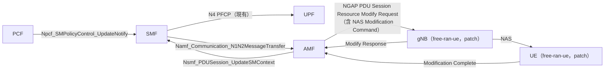
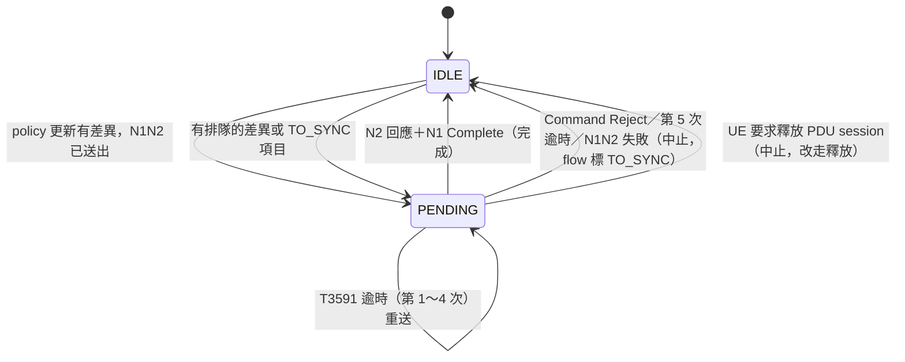
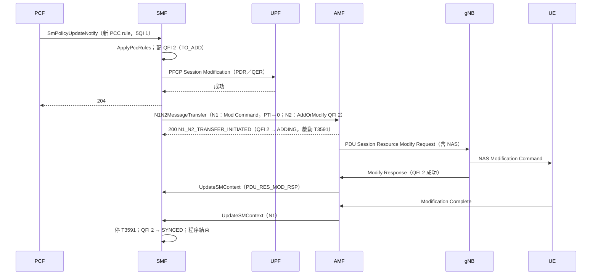
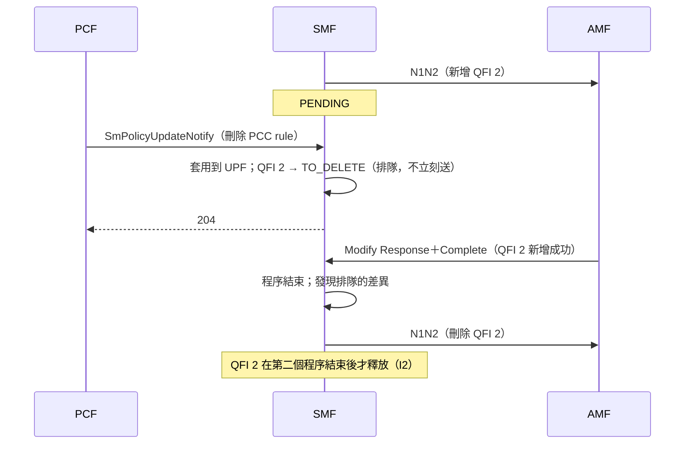
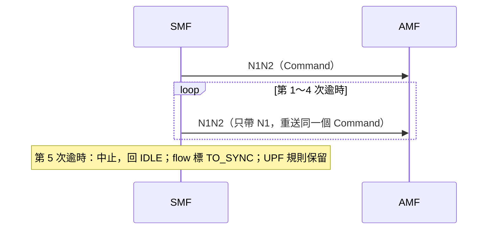
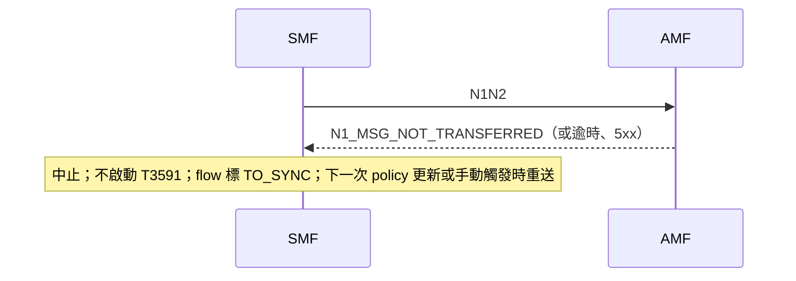
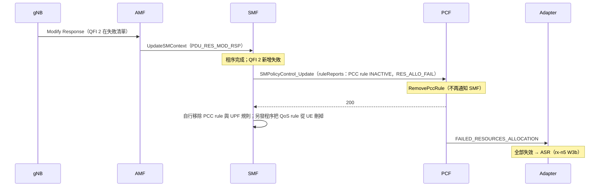

# SMF 網路發起的 QoS flow 修改（N1／N2）設計文件

| 項目 | 內容 |
|---|---|
| 版本／狀態 | v0.3／設計審查中（2026-10-22：v0.2 加入 W5c，v0.3 加入 W5b、W5d） |
| 作者 | 見 git log |
| 審查者 | TBD |
| 範圍 | W5a（新增與刪除）＋W5b（修改、UE 閒置時延後同步）＋W5c（回報 PCF）＋W5d（QoS notification control）＋W6（free-ran-ue 回應器 patch）；後續見 §13 |
| 相關文件 | [explained.md](explained.md)、[interface-spec.md](interface-spec.md)、[test-plan.md](test-plan.md)、[adr/](adr/)、總計畫 [vonr-ims-nf-plan.md](../overview/vonr-ims-nf-plan.md) W5、W6 |

## 1. 摘要

PCF 因為通話建立或結束而更新 SM policy 時，free5gc SMF 現在只改 UPF 規則，gNB 與 UE 不知道語音 QoS flow 的存在。本設計讓 SMF 依 TS 23.502 §4.3.3.2 步驟 3b 執行網路發起的 PDU Session Modification：經 AMF 送出 N2 PDU Session Resource Modify Request Transfer 與 N1 PDU SESSION MODIFICATION COMMAND，處理回應、T3591 重送與各種衝突。範圍只有非預設 QoS flow 的新增與刪除；不改 Session-AMBR、預設 QoS 規則，也不處理 UE 發起的修改。

最大的取捨：
- **free-ran-ue 完全不處理這兩個訊息**，所以要另外 patch 它，才能把整個程序跑完（[ADR-0005](adr/0005-patch-free-ran-ue-responder.md)）。
- **要刪掉的 QoS flow 不能依賴 PCF 告訴 SMF**，因為 PCF 的刪除通知不帶 QosDecs；SMF 必須自己從 PCC rule 的差異推導（[ADR-0002](adr/0002-derive-qos-flow-diff-from-pcc-rules.md)）。

## 2. 背景與動機

| 缺口 | 後果 | 依據 |
|---|---|---|
| `HandleSMPolicyUpdateNotify` 套用 PCC rule、更新 UPF 後就回 204，沒有 N1N2 | gNB 不知道 5QI 1 的 flow；UE 沒有對應的 QoS rule。在真的 RAN 上，語音沒有專屬無線資源 | `smf/internal/sbi/processor/notifier.go`（v1.4.6） |
| `BuildGSMPDUSessionModificationCommand` 只填 PDU session ID 和 PTI | 就算送出，也不帶任何 QoS rule 或 flow description | `smf/internal/context/gsm_build.go` |
| 該 builder 的 PTI 用 `smContext.Pti`（UE 上一次的 PTI） | 網路發起時違反 TS 24.501 §6.3.2.2（應為「No procedure transaction identity assigned」） | 同上；TS 24.501 V17.18 §6.3.2.2 |
| `BuildPDUSessionResourceModifyRequestTransfer` 只有新增／修改清單 | 無法通知 RAN 刪除 QoS flow | `smf/internal/context/ngap_build.go` |
| PCF 刪除 app session 時，通知只把 PCC rule 標為 nil，不標 QosDecs | SMF 只在 QosDecs 為 nil 時釋放 QFI（`RemoveQFI`），所以通話結束後 QoS flow 留在 `AdditionalQosFlows`、QFI 不釋放（原始碼推論，G0 實測） | `pcf/internal/context/ue.go` `RemovePccRule`；`smf/internal/context/sm_context_policy.go` |
| free-ran-ue gNB 的 NGAP dispatcher 沒有 PDU Session Resource Modify Request；UE 只處理 Establishment Accept／Reject 與 Release Command | 就算 SMF 送出，實驗環境也收不到回應，程序永遠停在等待 | free-ran-ue `gnb/ngapDispatcher.go`、`ue/ue.go` |
| SMF 只在 UE 要求修改時才送 SM policy update，從不回報 ruleReports；AMF 會把 `PDU_RES_NTY` 轉給 SMF，但 SMF 沒有處理它 | RAN 拒絕或釋放語音 QFI 時，PCF 與 IMS 都不知道，通話不會結束（TS 23.228 附錄 Y.2.4 的缺口） | `smf/internal/sbi/consumer/pcf_service.go`；`amf/internal/ngap/handler.go` |

## 3. 目標與非目標

**目標（W5a＋W6）**

1. 通話建立時，PCF 新增語音 PCC rule 後，SMF 送出帶新增 QoS rule 與 QoS flow description 的 Modification Command，以及帶 QosFlowAddOrModifyRequestList 的 N2 transfer；抓包可驗證內容。
2. 通話結束時，SMF 推導出要刪除的 QoS flow，送出刪除 QoS rule／flow description 的 Command，以及帶 QosFlowToReleaseList 的 N2 transfer；QFI 在程序結束後才釋放。
3. 回應、T3591 逾時、N1N2 失敗、UE 拒絕、程序進行中又收到 policy 更新、UE 同時要求釋放，每種情況都有定義好的結果（[interface-spec.md](interface-spec.md) §9）。
4. 在 patch 過的 free-ran-ue 上，`03-call-test.sh` 的一通電話能看到完整的 N2 Modify Request／Response 與 Modification Command／Complete，UPF、SMF、RAN、UE 的 QoS flow 一致。
5. 功能可用設定關閉；關閉時 SMF 行為與上游相同。
6. （W5c）RAN 拒絕或釋放語音 QFI 時，SMF 以 ruleReports 回報 PCF，PCF 再通知 Adapter，最後由 Kamailio 結束通話（與 rx-n5 的 W3b 串成一條鏈）。
7. （W5b）PCF 修改既有語音規則的頻寬時，以 `QFD_Mod` 與 AddOrModify 通知 UE 與 RAN；UE 閒置時不送，等 UP 啟動後只送 N1 補上。
8. （W5d）PCC rule 要求 QoS notification control 時，N2 帶 Notification Control；RAN 回報 GFBR 無法保證或恢復時，SMF 以 `qncReports` 回報 PCF。

**非目標**

| 非目標 | 為什麼這次不做 | 何時做 |
|---|---|---|
| Alternative QoS profile、以 NAS 告知 UE 目前實際 QoS、handover 後的恢復規則 | 需要 RAN 支援；W5d 先做基本的通知 | W5e |
| Session-AMBR、mapped EPS bearer、redundant transmission、QoS monitoring、reflective QoS、ATSSS | 與語音 QoS flow 無關 | 不排定 |
| SMF 重啟後恢復進行中的程序 | free5gc SMF 的 SM context 只在記憶體 | 不排定 |
| 支援真實 gNB／手機 | 沒有設備 | 有設備時 |
| free-ran-ue 的 patch 送回上游 | 先證明 SMF 行為；patch 只做實驗所需的最小回應 | 依 D08 |

## 4. 一個例子

[explained.md](explained.md) 用一通電話走一遍：200 OK → PCF 新增 PCC rule → SMF 配 QFI 2、更新 UPF → N1N2 → gNB 回 Modify Response → UE 回 Modification Complete；BYE 後反向刪除。也列出 free-ran-ue 現在在哪一步卡住。

## 5. 設計

### 5.1 架構與責任



| 元件 | 負責 | 不負責 |
|---|---|---|
| SMF（fork） | 推導 QoS flow 差異；組 N1、N2；送 N1N2；管理程序狀態、T3591、衝突；程序結束後釋放 QFI | 決定 QoS（由 PCF 決定）；SIP |
| AMF（不改） | 轉送 N1N2 給 RAN；把 N2 回應與 N1 Complete 交回 SMF | — |
| free-ran-ue gNB（patch） | 收 Modify Request、把 NAS 轉給 UE、回 Modify Response | 真正的無線資源 |
| free-ran-ue UE（patch） | 解 Modification Command、記下 QoS rule、回 Complete；可注入故障 | 依 QoS rule 分類封包（GTP-U 不看 QFI） |

AMF 已經支援把 `PDU_RES_MOD_REQ` 轉成 NGAP（`amf/internal/sbi/processor/n1n2message.go`）；SMF 已經會處理 `PDU_RES_MOD_RSP` 與 `PDUSessModComplete`（`smf/internal/sbi/processor/pdu_session.go`、`smf/internal/context/ngap_handler.go`）。

### 5.2 資料模型與不變量

每個 QoS flow 多一個「同步狀態」（`QoSFlow.State` 目前只有 Unset、Set、ToBeModify）：

| 同步狀態 | 意思 |
|---|---|
| TO_ADD | UPF 已有規則，還沒通知 RAN／UE |
| ADDING | 已在進行中的程序裡送出新增 |
| SYNCED | RAN 回成功、UE 回 Complete |
| TO_DELETE | PCC rule 已刪，還沒通知 RAN／UE |
| DELETING | 已在進行中的程序裡送出刪除 |
| TO_SYNC | 程序中止或 RAN／UE 拒絕，與 UE 狀態不一致，等下一次程序修正 |

不變量：

- **I1** 每個 PDU session 同時最多一個進行中的網路發起修改程序（[ADR-0003](adr/0003-one-procedure-per-session.md)）。
- **I2** QFI 在它的刪除程序結束（成功或中止）之前不得重新配給別的 flow（REQ-TRIG-03）。
- **I3** UPF 沒有成功套用的規則，不得通知 RAN／UE（REQ-TRIG-02）。
- **I4** 預設 QoS rule 與預設 QoS flow 永遠不出現在本程序的訊息裡。

### 5.3 狀態機



完整轉移表（含 N1N2 的各種回應、晚到的回應、進行中收到新 policy、UE 同時要求修改）見 [interface-spec.md](interface-spec.md) §9。

### 5.4 時序

**正常流程：通話建立時新增語音 QoS flow**



**最危險的競態：新增還沒完成，通話就結束了**



**逾時一：UE 不回 Complete（T3591）**



**逾時二：AMF 無法送達（N1_MSG_NOT_TRANSFERRED 或 HTTP 失敗）**



**W5c：RAN 拒絕語音 QFI → 回報 PCF → 通話結束**



### 5.5 程式結構

```
smf/internal/
├── context/
│   ├── qos_flow.go           # 加同步狀態（§5.2）
│   ├── qos_flow_diff.go      # 新增：由 PCC rule 差異推導 TO_ADD／TO_DELETE（純函式）
│   ├── gsm_build.go          # Modification Command 帶 QoS rule、flow description；PTI 由呼叫者決定
│   └── ngap_build.go         # Modify Request Transfer 加 QosFlowToReleaseList
└── sbi/processor/
    ├── notifier.go           # HandleSMPolicyUpdateNotify：PFCP 成功後交給 nwmod
    └── nwmod.go              # 新增：網路發起修改程序的狀態機（§9.2），T3591，排隊
```

`qos_flow_diff.go` 與 `nwmod.go` 的轉移函式不碰網路：輸入「目前狀態＋事件」，輸出「要送的訊息＋新狀態」，可以逐列做表格驅動測試。N1、N2 的組裝重用現有的 `PCCRule.BuildNasQoSRule`、`QoSFlow.BuildNasQoSDesc`、`BuildNgapQosFlowAddOrModifyRequestItem`；NAS 函式庫 `free5gc/nas` v1.3.0 已有 `OpCode_DelExistingQosRule` 與 `QFD_Del`。

free-ran-ue 的改動做成 `kamailio-free5gc/ran/` 下的 patch，跟現有的 `pcscf-discovery.patch` 一樣在 build 時套用。

### 5.6 部署

| 項目 | 改法 |
|---|---|
| SMF | 改用自己 build 的映像（現在是 `free5gc/smf:v4.2.3`）；版本與 W8 的 UDM／UDR 一致（D01） |
| `config/smfcfg.yaml` | 新增 `networkInitiatedModification.enable`；T3591 的 `maxRetryTimes` 由 3 改為 4（REQ-CFG-02） |
| free-ran-ue | `ran/Dockerfile` 在 `pcscf-discovery.patch` 之後套用新的 patch |
| AMF、PCF、UPF | 不改 |

## 6. 考慮過的替代方案

| 方案 | 做法 | 優點 | 缺點 | 結論 |
|---|---|---|---|---|
| A. 依 TS 23.502 §4.3.3.2 步驟 3b，在 SMF 做完整的網路發起修改（N1＋N2） | 本設計 | **最接近標準**；UPF、RAN、UE 一致 | 要 fork SMF；free-ran-ue 要 patch | **採用**（[ADR-0001](adr/0001-network-initiated-modification-in-smf.md)） |
| B. 維持現況（只改 UPF） | 不做 | 不用改 | RAN／UE 不知道語音 flow；不符合 23.502 | 不採用 |
| C. 只送 N2、不送 N1 | RAN 建立資源，UE 不知道 QoS rule | 比較簡單 | UE 的上行封包不會被分類到語音 flow；TS 24.501 §6.3.2.2 要求 QoS rule 變更要通知 UE | 不採用 |
| D. 預先在 PDU session 建立時就建好語音 flow | Establishment Accept 就帶 5QI 1 | 不用 modification | 違背依需求配置 GBR 資源的用意；與 PCF 的 app session 脫鉤 | 不採用 |
| E. 只驗證 SMF 送出的訊息，不 patch free-ran-ue | 抓包看 N2 Request 內容 | 不動 free-ran-ue | 程序永遠停在 PENDING，T3591 必然逾時；回應處理、衝突都無法端到端驗證 | 不採用，見 [ADR-0005](adr/0005-patch-free-ran-ue-responder.md) |

## 7. 跨面向考量

### 7.1 安全（威脅模型）

| 威脅 | 入口 | 對策 | 需求 |
|---|---|---|---|
| 偽造的 UpdateSMContext 讓 SMF 以為 RAN 已建立 flow | AMF → SMF SBI | 沿用 free5gc 的 SBI；OAuth 關閉屬實驗 profile | REQ-OBS-01（記錄來源） |
| 晚到或重複的回應覆蓋新程序的狀態 | UpdateSMContext | 以程序序號比對，不符就忽略 | REQ-RSP-04 |
| 大量 policy 更新造成 N1N2 風暴 | PCF | 每個 session 一個程序、差異排隊合併 | REQ-ST-01 |
| UE 被塞入超過能力的 packet filter | N1 | 檢查 UE 宣告的最大 packet filter 數 | REQ-N1-05 |

### 7.2 可觀測性

每個程序一筆紀錄：PDU session、程序序號、新增與刪除的 QFI、狀態轉移、N1N2 回應 cause、T3591 次數、結果（REQ-OBS-01、REQ-OBS-02）。

### 7.3 維運

- 關閉開關（`networkInitiatedModification.enable: false`）即回到上游行為，作為回退手段（REQ-GEN-01）。
- 卡在 TO_SYNC 的 flow：下一次任何 policy 更新會一起送；不另外提供手動觸發（W5b 再評估）。

## 8. 非功能需求

| 項目 | 提案值 | 依據 |
|---|---|---|
| 通知 PCF 的回應時間 | 不因 N1N2 而變長（N1N2 在回 204 之後才送） | REQ-TRIG-05 |
| 從 policy 更新到送出 N1N2 | 實驗環境 p99 < 500 ms | 語音建立時 200 OK 之後的媒體開始時間；無標準數值 |
| T3591 | 16 秒、重送 4 次 | 部署的 `smfcfg.yaml` 用 16 秒；重送次數依 TS 24.501 §6.3.2.5 |

## 9. 假設、依賴與風險

**假設**

- 一通電話對每支 UE 只新增一條 5QI 1 的 PCC rule（Rx／N5 Adapter 一個 Rx session 一個 app session）。
- 實驗 UE 通話期間保持 CM-CONNECTED。

**依賴**

- W1（抓包驗收）、W3a（PCF 會真的發出新增／刪除）、W7／D01（版本）。

| 風險 | 影響 | 可能性 | 對策 | 何時驗證 |
|---|---|---|---|---|
| **free-ran-ue 不處理 Modify Request 與 Modification Command**（已確認） | 沒有 patch 就無法端到端驗證，整個 W5 只能驗到「送出」 | 已發生 | W6 patch（ADR-0005，已接受） | G2 |
| **PCF 刪除通知不帶 QosDecs，SMF 不釋放 QoS flow**（原始碼推論） | 刪除永遠不會被觸發；QFI 漏掉 | 高 | 由 PCC rule 差異推導（ADR-0002）；G0 實測現況 | G0 |
| 5QI 1 是 GBR，但 PCF 只有在 Rx 帶 Min-Requested-Bandwidth 時才填 GBR | N2 的 GBR QoS 資訊缺 GFBR，真 RAN 可能拒絕；flow description 不完整 | 中 | D04 決定 GFBR 來源；G0 抓 PCF 給 SMF 的 QosData | G0／G1 |
| free5gc AMF 在 UE 閒置時收下 `PDU_RES_MOD_REQ`，Service Request 後卻丟掉（`HandleServiceRequest`） | 閒置時送的修改會遺失 | 已知（原始碼） | UP 未啟動時不送，啟動後只送 N1（ADR-0009） | G2 |
| free5gc PCF 轉給 AF 的 QOS_NOTIF 沒有 `qncReports` | AF 分不出無法保證或恢復，W5d 端到端不通 | 已知（原始碼） | ADR-0010；D13 | G1 |
| 部署的 SMF（4.2.3）與查證的原始碼（v1.4.6）行為不同 | 設計依據失效 | 中 | D01、W7 | G0 |
| TS 38.413、29.502、29.518 本機沒有 | N2 IE 與 N1N2 cause 的細節只能依 free5gc 程式碼 | 中 | D02 取得並核對 | G1 |

## 10. 參考過的作法（prior art）

| 來源 | 借鏡什麼 | 不採用什麼 |
|---|---|---|
| free5gc SMF 的 UE 發起修改（`pdu_session.go` 的 `PDUSessModReq` 分支、`sendGSMPDUSessionModificationCommand`） | N1N2 的送法、T3591 計時器 | 用 UE 的 PTI；同步呼叫 AMF 時持有 `SMLock` |
| free5gc SMF 的 Establishment Accept（`BuildGSMPDUSessionEstablishmentAccept`） | QoS rule 與 flow description 的組法、`PCCRuleIDToQoSRuleID` | — |
| free5gc SMF 的 PDU session 釋放（`sendGSMPDUSessionReleaseCommand`） | N1N2 cause 的處理方式 | — |
| `kamailio-free5gc/ran/pcscf-discovery.patch` | 對 free-ran-ue 加最小 patch、build 時套用的方式 | — |

## 11. 宣稱範圍與限制

- 本組文件的「**必須**／**不得**」是本專案的要求；引用的條款都附版本與章節，標「候選」「待核對」的不能當成符合性依據。
- 完成後可以宣稱：「在 kamailio-free5gc 實驗環境中，free5gc SMF（fork）會在 PCF 新增或刪除語音 PCC rule 時，依 TS 23.502 §4.3.3.2 經 AMF 通知 RAN 與 UE，並在 patch 過的 free-ran-ue 上完成程序。」
- 不能宣稱：
  - 真實 RAN／手機能正確處理（free-ran-ue 的 patch 只是回應器，不做無線資源，GTP-U 也不看 QFI）；
  - 語音品質因此改善；
  - 支援 QoS flow 參數修改、延後同步、SMF 重啟恢復；
  - 完整符合 TS 24.501 §6.3.2（非目標列出的部分沒做）。

## 12. 待解問題

| # | 問題 | 關閉條件 | 負責 | 期限 |
|---|---|---|---|---|
| D01 | 要 fork 的 free5gc 版本：部署 SMF 4.2.3，本機原始碼 v1.4.6；要與 W8 一致 | W7 結論寫進 manifest | TBD | G0 |
| D02 | 取得並核對 TS 38.413（Modify Request／Response IE、QosFlowToReleaseList 的 cause）、TS 29.502（UpdateSMContext）、TS 29.518（N1N2MessageTransfer 的 cause） | interface-spec §2、§10 的核對欄填完 | TBD | G1 |
| D03 | 現況實測：通話結束後 SMF 是否真的沒有釋放 QoS flow／QFI | G0 用 SMF log 與 UPF 規則快照確認 | TBD | G0 |
| D04 | GBR flow 的 GFBR 來源。TS 29.513 V17.14.0 Table 7.3.2-1 規定：Rx 沒帶 Minimum Requested Bandwidth 時，GBR「as set by the operator」，也就是 PCF 應給營運商設定的值；free5gc PCF 沒做。選項：SMF 用 MFBR 當 GFBR、拒絕送出，或改 PCF | 決定並更新 REQ-N2-02 | TBD | G1 |
| D05 | T3591 重送時要不要再帶 N2（TS 24.501 只說重送 Command；23.502 沒寫） | 核對 TS 24.501 §6.3.2.5 與 29.518 並決定 | TBD | G1 |
| D06 | UE 宣告的「最大 packet filter 數」在 SMF 是否有保存；沒有時用多少 | 讀 SMF 的 Establishment Request 處理並決定 | TBD | G1 |
| D07 | QosFlowToReleaseList 的 NGAP cause 值 | D02 之後決定 | TBD | G1 |
| D08 | free-ran-ue patch 是否要送回上游 | 決定 | TBD | G4 |
| D09 | 是否要對 `free5gc/smf` 發 PR（計畫原本「待決定」） | 決定 | TBD | G4 |
| D10 | TS 29.512 的 ruleReports 語意：INACTIVE 回報時需不需要 policy control request trigger、`failureCode` 用 RES_ALLO_FAIL 是否正確、RAN 主動釋放時用哪個值 | 取得 TS 29.512 並核對；更新 interface-spec §10 | TBD | G1 |
| D11 | TS 29.512 的 `qncReports` 規則（§4.2.4.20，條號只見於 free5gc PCF 註解） | 取得 TS 29.512 並核對 REQ-QNC-03 | TBD | G1 |
| D12 | free-ran-ue 能否讓 UE 進入 CM-IDLE 並做 Service Request（REQ-RAN-08） | 讀原始碼或實測 | TBD | G1 |
| D13 | 是否修 PCF 的 QOS_NOTIF 通知內容（interface-spec 附錄 D） | 決定；不修則 W5d 端到端標 BLOCKED | TBD | G1 |

## 13. 後續階段

| 階段 | 內容 | 已知事項 |
|---|---|---|
| W5e | Alternative QoS profile（TS 23.501 §5.7.2.4.1b～5.7.2.4.3） | 需要 RAN 回報 CurrentQoSParaSetIndex；`free5gc/ngap` 已有欄位 |
